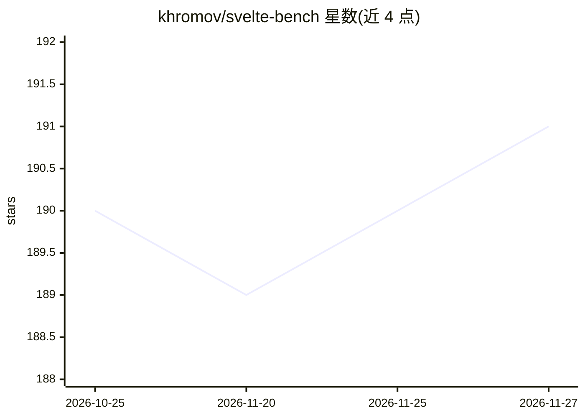

# khromov/svelte-bench

⭐ 191 · TypeScript · 推送 2026-11-26 · [GitHub](https://github.com/khromov/svelte-bench) · [官网](https://khromov.github.io/svelte-bench/benchmark-results-merged.html) · 个人维护

**评测 LLM 生成 Svelte 5 组件能力的基准测试工具**

基于 OpenAI HumanEval 论文方法论构建的基准，通过向 LLM 发送提示、生成 Svelte 5 组件并运行 Vitest 测试套件验证功能，计算 pass@1/pass@10 指标。支持十余家 LLM 接入商及本地 Ollama 运行时，提供 CLI（环境变量/.env 配置）、可选 Go 编写的 TUI 交互界面、批量脚本与结果 HTML 可视化。需 Node.js 24 与 pnpm；支持断点续跑、指数退避重试、上下文文件注入，测试集可在 src/tests/ 下自行扩展。

## 筛选速览

| 维度 | 判定 | 备注 |
|---|---|---|
| AI 角色 | `ai-ecosystem` | LLM/agent 周边工具 |
| 许可风险 | `none` | — |
| 部署形态 | `library` | 以包/库形式分发 |
| 模型依赖 | local-ok | 支持本地模型 |
| 硬件要求 | — | 无带数字的原话,不猜 |
| 安装摩擦 | `low` | 无编译、无系统依赖或容器化 |
| 成熟度 | — | 结构信号不足 |

## 能力要点

- HumanEval 方法论的 pass@k 指标（每测试默认 10 个样本）
- 支持 OpenAI/Anthropic/Gemini/Ollama 等十余家提供商
- 样本级 checkpoint 自动保存与断点续跑
- pnpm run build 生成交互式 HTML 结果可视化

## 适用场景

- 比较不同 LLM 生成 Svelte 5 runes 组件的正确率
- 在选型前批量评测多个模型对现代 Svelte 特性的掌握
- 用 Ollama 本地跑分并测量 tokens/秒生成速度

## 场景标签

`模型评测` · 领域:评测与运维

## 证据(README 行号)

> L3: An LLM benchmark for Svelte 5 based on the HumanEval methodology from OpenAI's paper "Evaluating Large Language Mode
> L7: SvelteBench evaluates LLM-generated Svelte components by testing them against predefined test suites. It works by se

## 星数曲线

2026-10-25 190 → 2026-11-27 191（+1）

---
*卡片 v1 · prompt 1.4 · 生成 2026-11-26 · 置信度 high · 依据 README sha `038e0a9df7d7` · [字段定义](../../DATASET.md)*
