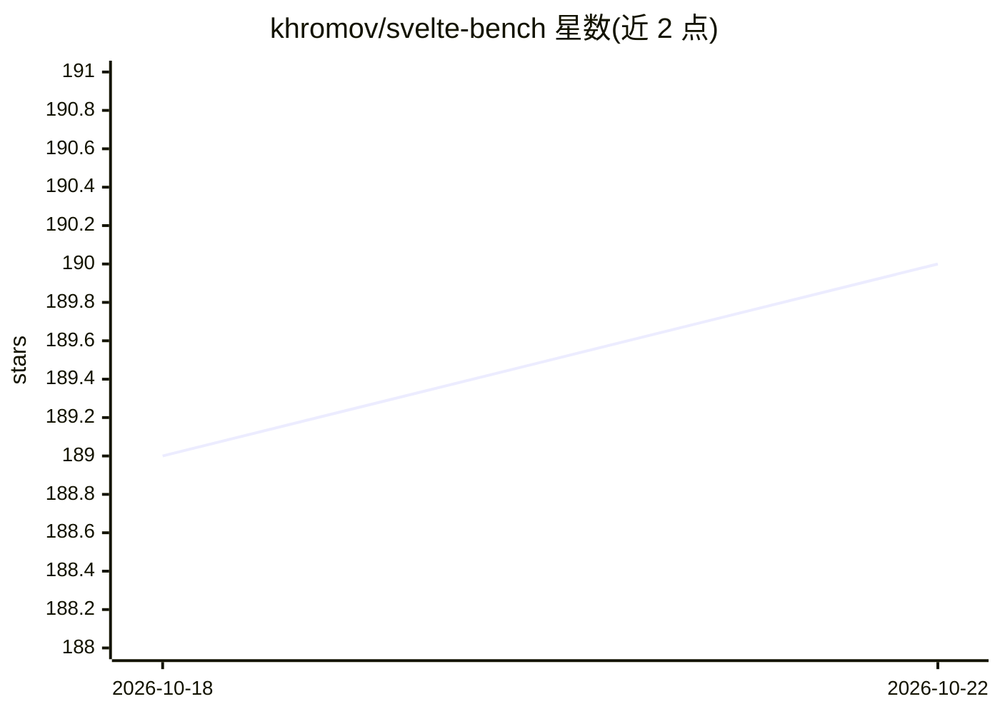

# khromov/svelte-bench

⭐ 190 · TypeScript · 推送 2026-10-19 · [GitHub](https://github.com/khromov/svelte-bench) · [官网](https://khromov.github.io/svelte-bench/benchmark-results-merged.html) · 个人维护

**评测 LLM 生成 Svelte 5 组件能力的基准（pass@k）**

基于 HumanEval 方法论的代码生成基准，专测 LLM 编写 Svelte 5 组件（runes 等现代特性）的能力：向模型发送提示词生成组件，用 Vitest 测试与参考实现自动验证，计算 pass@1/pass@10 指标。支持 13 个 provider 含本地 Ollama；提供结果可视化（HTML 排行榜）、断点续跑、重试、上下文文件注入、Ollama 模型速度（tokens/s）与平均响应时长测量。可选 Go 编写的 TUI 交互前端。需 Node.js 24 与 pnpm 运行。

## 筛选速览

| 维度 | 判定 | 备注 |
|---|---|---|
| AI 角色 | `ai-ecosystem` | LLM/agent 周边工具 |
| 许可风险 | `none` | — |
| 部署形态 | `library` | 以包/库形式分发 |
| 模型依赖 | local-ok | 支持本地模型 |
| 硬件要求 | — | 无带数字的原话,不猜 |
| 安装摩擦 | `low` | 无编译、无系统依赖或容器化 |
| 成熟度 | — | 结构信号不足 |

## 能力要点

- pass@1/pass@10 指标，10 样本/测试的自动验证
- 13 个 provider 支持（OpenAI/Anthropic/Gemini/Ollama 等）
- Ollama 本地模型的速度（tokens/s）与平均响应测量
- 样本级断点续跑与指数退避重试

## 适用场景

- 比较各 LLM 生成 Svelte 5 组件的准确率
- 评测本地 Ollama 模型的生成质量与速度
- 为选型 Svelte 项目编码模型提供参考数据

## 场景标签

 · 领域:LLM 评测/前端开发

## 证据(README 行号)

> L3: An LLM benchmark for Svelte 5 based on the HumanEval methodology from OpenAI's paper "Evaluating Large Language Mode
> L7: SvelteBench evaluates LLM-generated Svelte components by testing them against predefined test suites. It works by se

## 星数曲线

2026-10-18 189 → 2026-10-22 190（+1）

---
*卡片 v1 · prompt 1.4 · 生成 2026-10-22 · 置信度 high · 依据 README sha `e4e1ad895eac` · [字段定义](../../DATASET.md)*
