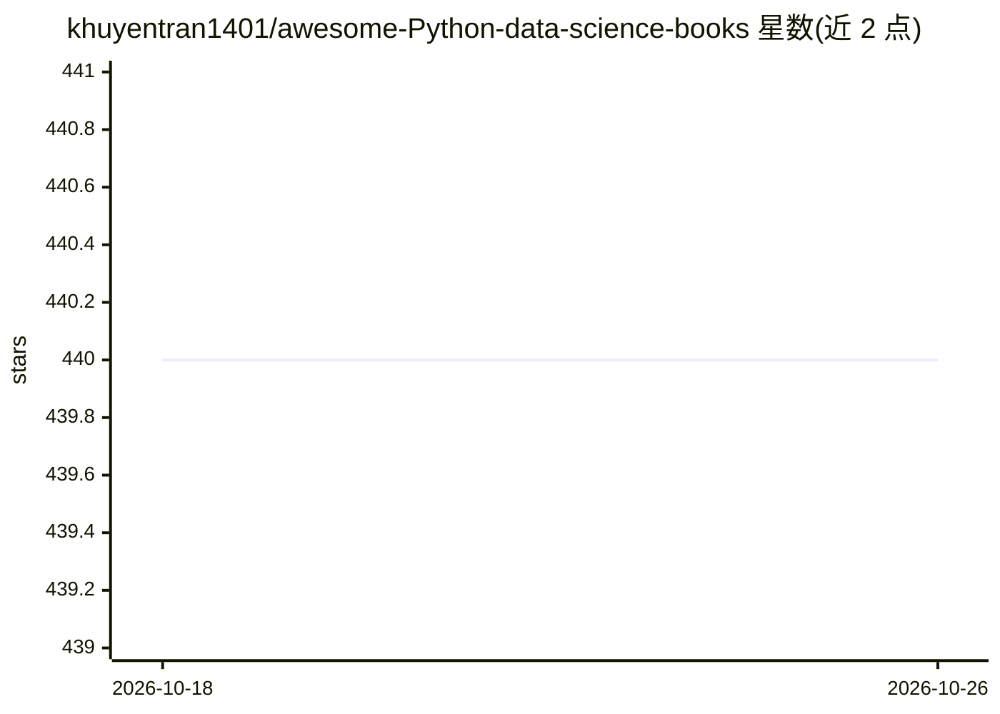

# khuyentran1401/awesome-Python-data-science-books

⭐ 440 · 推送 2025-11-02 · [GitHub](https://github.com/khuyentran1401/awesome-Python-data-science-books) · [官网](https://khuyentran1401.github.io/awesome-Python-data-science-books/) · 个人维护

**Python 数据科学书籍策展清单（awesome-list）**

由个人维护的 awesome 类型清单，收录 Python 数据科学相关书籍资源，条目以固定 markdown 格式组织，书籍摘要以 "Learn..." 开头。内容按分类目录组织（Contents 部分在可见范围外）。社区可通过 fork、按格式添加条目、提交 PR 或创建 issue 推荐书籍的方式贡献，维护者审核后收录。不提供代码、安装或运行内容，纯为阅读与查找资源服务。

## 筛选速览

| 维度 | 判定 | 备注 |
|---|---|---|
| AI 角色 | `ai-knowledge` | 知识聚合/清单类 |
| 许可风险 | `none` | — |
| 部署形态 | `None` |  |
| 模型依赖 | — | README 未给出锁定关系 |
| 硬件要求 | — | 无带数字的原话,不猜 |
| 安装摩擦 | `low` | 无编译、无系统依赖或容器化 |
| 成熟度 | — | 结构信号不足 |

## 能力要点

- 按分类组织的 Python 数据科学书籍清单
- 固定条目格式（摘要以 "Learn..." 开头）
- 开放贡献流程：fork → 添加 → PR / issue 推荐

## 适用场景

- 按分类查找 Python 数据科学、机器学习相关书籍
- 为数据科学学习路线挑选参考书
- 向社区推荐或补充书籍资源

## 场景标签

`精选清单` · 领域:学习与行业

## 证据(README 行号)

> L3: # Awesome Python Data Science Books Awesome
> L4: Probably the best curated list of data science books in Python.

## 星数曲线

2026-10-18 440 → 2026-10-26 440（+0）

---
*卡片 v1 · prompt 1.4 · 生成 2026-10-21 · 置信度 high · 依据 README sha `96adb652d42c` · [字段定义](../../DATASET.md)*
