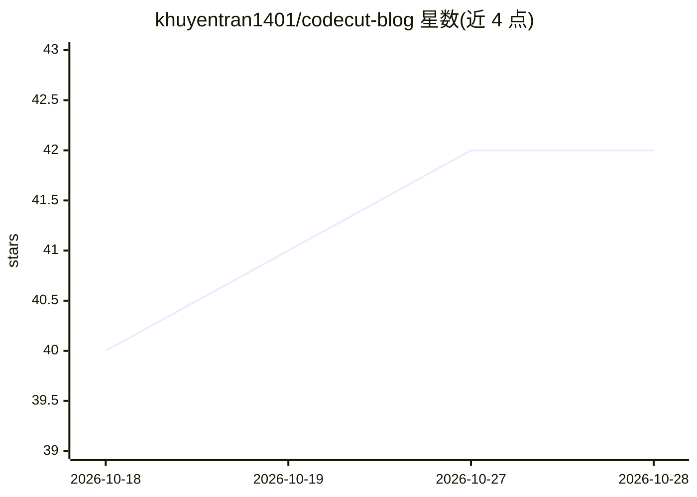

# khuyentran1401/codecut-blog

⭐ 42 · Jupyter Notebook · 推送 2026-10-28 · [GitHub](https://github.com/khuyentran1401/codecut-blog) · [官网](https://codecut.ai/blog) · 个人维护

**45+ 篇数据科学/MLOps/AI 工具教程的代码仓库**

Khuyen Tran 维护的 CodeCut 博客配套代码仓库，收录 45+ 篇可执行技术教程，覆盖数据工程（PySpark、DuckDB、DVC、Delta Lake）、机器学习（贝叶斯优化、MLflow、pytest）、LLM 应用（LangChain+Ollama、Pydantic AI、RAG、pgvector）及可视化与数据工具。每个 notebook 顶部列出依赖，通过 git clone 后 pip/uv 安装运行；文章版权归属作者，文中代码示例以 MIT 许可复用。

## 筛选速览

| 维度 | 判定 | 备注 |
|---|---|---|
| AI 角色 | `ai-knowledge` | 知识聚合/清单类 |
| 许可风险 | `none` | — |
| 部署形态 | `library` | 以包/库形式分发 |
| 模型依赖 | — | README 未给出锁定关系 |
| 硬件要求 | — | 无带数字的原话,不猜 |
| 安装摩擦 | `low` | 无编译、无系统依赖或容器化 |
| 成熟度 | — | 结构信号不足 |

## 能力要点

- 45+ 篇可执行、可适配真实项目的技术教程
- 覆盖数据工程、ML、LLM 应用、可视化四大类工具
- 依赖在各 notebook 顶部列出，支持 uv 加速安装

## 适用场景

- 学习 PySpark/DuckDB/DVC 等数据工程工具的实操用法
- 参考 LangChain+Ollama、RAG、pgvector 搭建本地 LLM 应用
- 为真实项目寻找可直接改编的示例代码

## 场景标签

`教程课程` · 领域:学习与行业

## 证据(README 行号)

> L14: This repository contains 45+ comprehensive technical articles covering data science, MLOps, and AI tools.
> L7: These notebooks are from **CodeCut**. CodeCut features open-source Python data science tools explained in clear, dig

## 星数曲线

2026-10-18 40 → 2026-10-28 42（+2）

---
*卡片 v1 · prompt 1.4 · 生成 2026-10-25 · 置信度 high · 依据 README sha `13e38f4018d4` · [字段定义](../../DATASET.md)*
