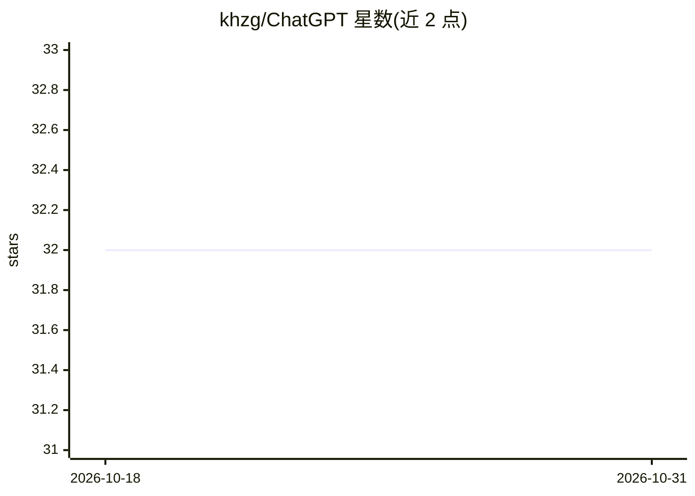

# khzg/ChatGPT

⭐ 32 · HTML · 推送 2026-07-05 · [GitHub](https://github.com/khzg/ChatGPT) · [官网](https://addons.mozilla.org/en-US/firefox/addon/chatgpt-everywhere/) · 个人维护

**在任意网页侧边调用多家 AI 服务的 Firefox 扩展**

Firefox 浏览器扩展：在 Gmail、Google 等任意网页旁以扩展窗口形式打开 AI 网站对话，无需弹窗切换标签页。收录 OpenAI ChatGPT、Gemini、Copilot、DeepSeek、Perplexity、Suno、Stable Diffusion 等数十个 AI 网站，覆盖对话、图像生成、音乐、文档处理等类别。扩展本身不提供模型，仅提供入口聚合与并排展示。社区可提交新 AI 网站（要求有用且含免费额度），并设有付费推广位（$90/90天）。

## 筛选速览

| 维度 | 判定 | 备注 |
|---|---|---|
| AI 角色 | `ai-ecosystem` | LLM/agent 周边工具 |
| 许可风险 | `none` | — |
| 部署形态 | `None` |  |
| 模型依赖 | — | README 未给出锁定关系 |
| 硬件要求 | — | 无带数字的原话,不猜 |
| 安装摩擦 | `low` | 无编译、无系统依赖或容器化 |
| 成熟度 | — | 结构信号不足 |

## 能力要点

- 在任意网页旁并排打开 AI 网站对话窗口
- 收录数十个 AI 网站入口，覆盖对话/图像/音乐/PDF 处理
- 支持社区通过 issue 提交新 AI 网站

## 适用场景

- 浏览网页时随手调用 ChatGPT、Gemini 等 AI 对话
- 在 Gmail、Google 等页面旁对照 AI 回答
- 从一个入口快速切换多家 AI 服务

## 场景标签

`聊天机器人` · 领域:对话与助手

## 证据(README 行号)

> L5: Access Ai Chat anywhere on the web and Display ai response alongside websites for gmail, google and other websites. 
> L7: support OpenAI ChatGPT, Google Gemini, Copilot, Deepseek, Bing image, Perplexity Ai, Suno music, DuckDuckGo Ai, You 

## 星数曲线

2026-10-18 32 → 2026-10-31 32（+0）

---
*卡片 v1 · prompt 1.4 · 生成 2026-10-26 · 置信度 mid · 依据 README sha `d3bb91dc92ee` · [字段定义](../../DATASET.md)*
