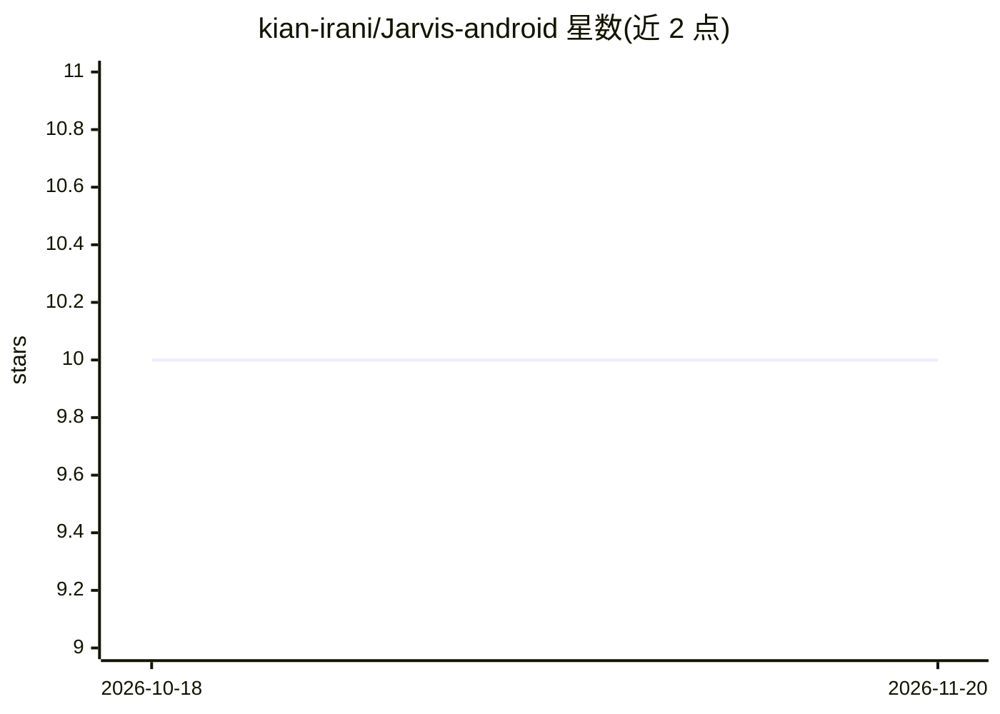

# kian-irani/Jarvis-android

⭐ 10 · Kotlin · NOASSERTION · 推送 2026-06-29 · [GitHub](https://github.com/kian-irani/Jarvis-android) · [官网](https://t.me/kian_irani_cdn_f) · 个人维护

**AI 驱动的 Android 启动器与个人智能层**

Vision OS（原 Jarvis-android）是一个 Android 启动器与个人智能层：启动器部分提供主页网格、文件夹、应用抽屉、布局备份等日常功能；AI 部分包含认知路由器（编排器、能力图、成本控制、令牌池）、Agent 引擎（计划-工具调用-执行）、端侧本地模型目录与分布式 Brain（Brain-Nano/Lite/Full 三级、设备 Mesh）。产品为 source-available 专有许可，需通过 Telegram bot 获取激活令牌（$3/月或 $30/年，14 天试用），代码仅可查看，商用/再分发/衍生被禁止，源码构建仅限 CLA 下的贡献。

## 筛选速览

| 维度 | 判定 | 备注 |
|---|---|---|
| AI 角色 | `ai-enhanced` | 去掉 AI 部分产品仍成立 |
| 许可风险 | `none` | NOASSERTION |
| 部署形态 | `None` |  |
| 模型依赖 | local-ok | 支持本地模型 |
| 硬件要求 | — | 无带数字的原话,不猜 |
| 安装摩擦 | `low` | 无编译、无系统依赖或容器化 |
| 成熟度 | `idea` | |

## 能力要点

- 多令牌 AI 路由：Claude、Gemini、Groq、OpenAI、Grok、OpenRouter、Ollama 等提供商，带回退链与成本面板
- 分布式 Brain：设备 Mesh 汇聚 CPU/RAM/GPU，Brain Score 自动选举与故障转移
- Agent 引擎支持真实函数调用（通话/短信/打开应用/设置/导航）
- 端侧本地模型目录，可断点续传下载，本地优先路由

## 适用场景

- 把 Android 桌面换成带 AI 助手的启动器
- 在自有硬件上运行个人 AI 助理而不依赖单一云厂商
- 多设备组网共享算力运行分布式 Brain
- 用自然语言调度手机操作（拨号、开应用、设置）

## 场景标签

`AI 助手` · 领域:对话与助手

## 证据(README 行号)

> L39: **Vision is an AI-native Android launcher built on a sovereign Personal Intelligence layer** —
> L97: |📱 **AI-native Launcher**|Real Android launcher — `HorizontalPager` home (orb on page 1), workspace grid + pages, d

## 星数曲线

2026-10-18 10 → 2026-11-20 10（+0）

---
*卡片 v1 · prompt 1.4 · 生成 2026-11-19 · 置信度 high · 依据 README sha `5fcd32a6b1b7` · [字段定义](../../DATASET.md)*
