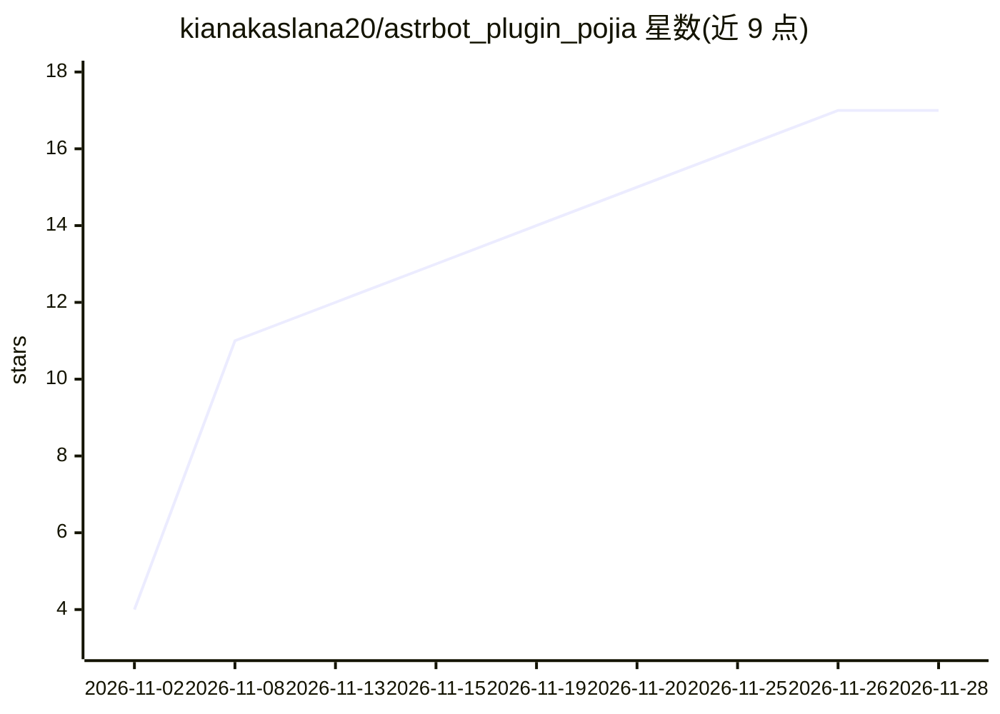

# kianakaslana20/astrbot_plugin_pojia

⭐ 17 · Python · MIT · 推送 2026-10-30 · [GitHub](https://github.com/kianakaslana20/astrbot_plugin_pojia) · 个人维护 · 中文 README

**AstrBot 插件：注入提示词并重试拒绝，绕开模型拒答**

面向 AstrBot 聊天机器人框架的第三方插件，解决接入第三方模型时的三类问题：模型自带对齐层导致拒答、首次被拒后无重试机制、平台敏感词过滤拦截输出。机制包括：通过 OnLLMRequestEvent 钩子把「执行者核心」提示词拼进 system prompt、检测到拒绝后带加压指令自动重试（最多 5 次）、可选输出绕词（星号/窄空格/同形字/零宽字符）。纯 Python 标准库实现，不依赖额外包，通过 AstrBot 插件目录安装。

## 筛选速览

| 维度 | 判定 | 备注 |
|---|---|---|
| AI 角色 | `ai-ecosystem` | LLM/agent 周边工具 |
| 许可风险 | `permissive` | MIT |
| 部署形态 | `None` |  |
| 模型依赖 | — | README 未给出锁定关系 |
| 硬件要求 | — | 无带数字的原话,不猜 |
| 安装摩擦 | `low` | 无编译、无系统依赖或容器化 |
| 成熟度 | — | 结构信号不足 |

## 能力要点

- 每次请求前向 system prompt 注入「执行者核心」提示词，带去重标记避免重复注入
- 拒绝检测（29 条正则）后自动带加压指令重试，最多 5 次，失败后可剥离拒绝句
- 可选输出绕词：星号 / 窄空格 / 同形字 / 零宽字符四种风格
- 支持会话白名单/黑名单、管理员命令 `/破甲` 控制开关与提示词热重载

## 适用场景

- AstrBot 接入国内模型或中转 API 时减少模型拒答
- 群聊机器人需要按会话粒度控制提示词注入开关
- 需要自定义越狱提示词文件并热重载生效

## 场景标签

`提示工程` · 领域:Agent 开发

## 证据(README 行号)

> L3: 给 AstrBot 里的模型穿上装甲：**执行者人格注入 + 拒绝自动重试 + 输出绕词**。
> L6: 移植成 AstrBot 插件形态：不靠改宿主源码，全部走 AstrBot 官方插件钩子。
> L18: ## 二、工作原理（对应 AstrBot v4.29.3 实际钩子）

## 星数曲线

2026-11-02 4 → 2026-11-28 17（+13）

---
*卡片 v1 · prompt 1.4 · 生成 2026-11-18 · 置信度 high · 依据 README sha `24657f5583ef` · [字段定义](../../DATASET.md)*
