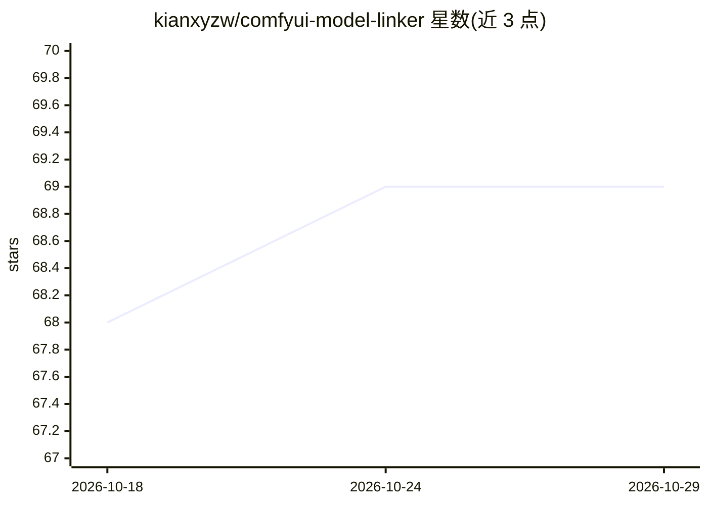

# kianxyzw/comfyui-model-linker

⭐ 69 · Python · MIT · 推送 2026-10-26 · [GitHub](https://github.com/kianxyzw/comfyui-model-linker) · 个人维护

**ComfyUI 扩展：为工作流缺失模型做模糊匹配重链与下载**

面向 ComfyUI 用户的自定义节点扩展：扫描工作流（含嵌套子图）中的模型引用，在本地文件中用模糊匹配（rapidfuzz，缺省回退 difflib）找出最相近文件，一键链接完全匹配项；缺失模型可从 HuggingFace 或 CivitAI 下载（多连接加速、SHA-256 哈希反查、API token 支持门控模型）。自动探测第三方 loader 节点的模型字段，无硬编码节点列表；修改在原图上原位应用，由用户自行保存。经 ComfyUI-Manager/Registry 或克隆到 custom_nodes 安装。

## 筛选速览

| 维度 | 判定 | 备注 |
|---|---|---|
| AI 角色 | `ai-ecosystem` | LLM/agent 周边工具 |
| 许可风险 | `permissive` | MIT |
| 部署形态 | `library` | 以包/库形式分发 |
| 模型依赖 | — | README 未给出锁定关系 |
| 硬件要求 | — | 无带数字的原话,不猜 |
| 安装摩擦 | `low` | 无编译、无系统依赖或容器化 |
| 成熟度 | — | 结构信号不足 |

## 能力要点

- 模糊匹配重链本地模型（区分 fp8/bf16/Q4_K_M 变体，避免 4B 误配 8B）
- 从 HuggingFace/CivitAI 下载缺失模型，支持 SHA-256 哈希反查
- 自动探测第三方 loader 节点的模型字段，无硬编码节点列表
- 跨平台路径匹配与错误文件夹警告

## 适用场景

- 打开他人分享的工作流后批量补齐缺失模型
- 把重命名过的本地模型重新链接到工作流节点
- 为分享的工作流导出模型下载链接清单

## 场景标签

 · 领域:AI 图像生成/模型管理

## 证据(README 行号)

> L3: A ComfyUI extension that relinks missing models in shared workflows: it finds the closest matches among your local f
> L9: - **Workflow scanning** — finds model references in all nodes, including nested subgraphs

## 星数曲线

2026-10-18 68 → 2026-10-29 69（+1）

---
*卡片 v1 · prompt 1.4 · 生成 2026-10-24 · 置信度 mid · 依据 README sha `db4941a1995d` · [字段定义](../../DATASET.md)*
