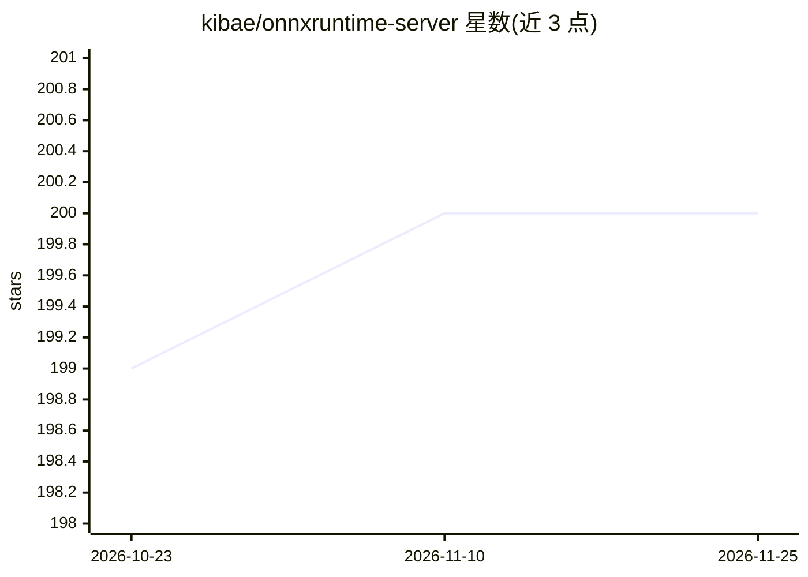

# kibae/onnxruntime-server

⭐ 200 · C++ · MIT · 推送 2026-11-14 · [GitHub](https://github.com/kibae/onnxruntime-server) · 个人维护

**为 ONNX 模型提供 TCP/HTTP REST 推理 API 的服务端**

基于 ONNX Runtime 的推理服务器：将导出为 ONNX 格式的模型放入约定目录结构即可自动提供推理 API，无需额外编写代码。支持 TCP 与 HTTP/HTTPS 后端，内置 Swagger API 文档，可分析模型输入/输出类型与形状信息。每个会话可选择 CPU 或 CUDA 执行；所有命令行选项可通过环境变量设置，便于容器部署。提供 Docker 镜像、AUR 包，也可从源码用 CMake 编译安装（依赖 Boost、CMake 等）。

## 筛选速览

| 维度 | 判定 | 备注 |
|---|---|---|
| AI 角色 | `ai-ecosystem` | LLM/agent 周边工具 |
| 许可风险 | `permissive` | MIT |
| 部署形态 | `self-host` | docker 或自建部署 |
| 模型依赖 | — | README 未给出锁定关系 |
| 硬件要求 | — | 无带数字的原话,不猜 |
| 安装摩擦 | `low` | 无编译、无系统依赖或容器化 |
| 成熟度 | — | 结构信号不足 |

## 能力要点

- 放置 ONNX 文件到目录结构即可提供推理 API，无需额外代码
- TCP 与 HTTP/HTTPS 双后端，内置 Swagger API 文档
- 每会话可选 CPU 或 CUDA 执行，支持会话级 SessionOptions 与 CUDA Provider 选项
- 支持 onnxruntime-extensions 自定义算子库与模型二进制上传

## 适用场景

- 把各种环境训练并导出的 ONNX 模型快速发布为推理 API
- 为协作者提供带 Swagger 文档的模型测试接口
- 在 Docker 容器中以环境变量配置运行推理服务

## 场景标签

`推理引擎` · 领域:训练与推理

## 证据(README 行号)

> L11: - **The ONNX Runtime Server is a server that provides TCP and HTTP/HTTPS REST APIs for ONNX inference.**
> L12: - ONNX Runtime Server aims to provide simple, high-performance ML inference and a good developer experience.
> L13:  - If you have exported ML models trained in various environments as ONNX files, you can provide inference APIs

## 星数曲线

2026-10-23 199 → 2026-11-25 200（+1）

---
*卡片 v1 · prompt 1.4 · 生成 2026-11-25 · 置信度 high · 依据 README sha `8e88eaa86a80` · [字段定义](../../DATASET.md)*
