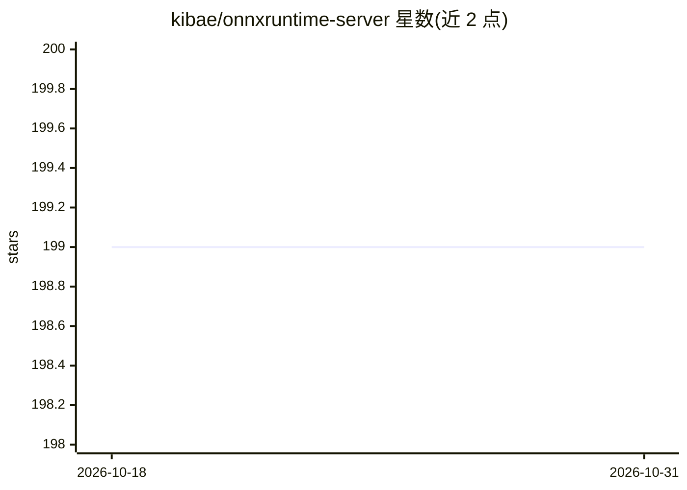

# kibae/onnxruntime-server

⭐ 199 · C++ · MIT · 推送 2026-10-27 · [GitHub](https://github.com/kibae/onnxruntime-server) · 个人维护

**为 ONNX 模型提供 TCP/HTTP(S) REST 推理 API 的服务器**

基于 ONNX Runtime 的推理服务器：将 ONNX 文件放入指定目录结构即可通过 TCP、HTTP/HTTPS REST API 提供推理服务，无需额外代码。支持每个会话选择 CPU 或 CUDA 后端、启动时预创建会话、内置 Swagger API 文档、TCP 模型流式上传（避免 OOM）、onnxruntime-extensions 自定义算子与会话级/CUDA 执行提供者选项透传。提供 Docker 镜像（CUDA12/13 与 CPU 版）、AUR 包，或从源码 CMake 编译；依赖 ONNX Runtime、Boost、CMake。注意官方 ORT 二进制默认开启遥测，可用 ORT_DISABLE_TELEMETRY 关闭。

## 筛选速览

| 维度 | 判定 | 备注 |
|---|---|---|
| AI 角色 | `ai-ecosystem` | LLM/agent 周边工具 |
| 许可风险 | `permissive` | MIT |
| 部署形态 | `self-host` | docker 或自建部署 |
| 模型依赖 | — | README 未给出锁定关系 |
| 硬件要求 | — | 无带数字的原话,不猜 |
| 安装摩擦 | `low` | 无编译、无系统依赖或容器化 |
| 成熟度 | — | 结构信号不足 |

## 能力要点

- ONNX 文件按目录放置即自动暴露 TCP/HTTP(S) 推理 API
- 每会话可选 CPU 或 CUDA 执行提供者
- 内置 Swagger API 文档与模型输入/输出类型形状分析
- Docker 镜像开箱即用，无需本地编译

## 适用场景

- 把已导出的 ONNX 模型快速部署为团队可调用的推理服务
- 通过 Swagger UI 让协作方直接测试 ML 模型 API
- 在 Docker/K8s 中以环境变量配置运行 GPU 推理服务

## 场景标签

`推理引擎` · 领域:训练与推理

## 证据(README 行号)

> L11: - **The ONNX Runtime Server is a server that provides TCP and HTTP/HTTPS REST APIs for ONNX inference.**
> L12: - ONNX Runtime Server aims to provide simple, high-performance ML inference and a good developer experience.
> L16:  - Each ONNX session, you can choose to use CPU or CUDA.

## 星数曲线

2026-10-18 199 → 2026-10-31 199（+0）

---
*卡片 v1 · prompt 1.4 · 生成 2026-10-22 · 置信度 high · 依据 README sha `fdb5039a847b` · [字段定义](../../DATASET.md)*
