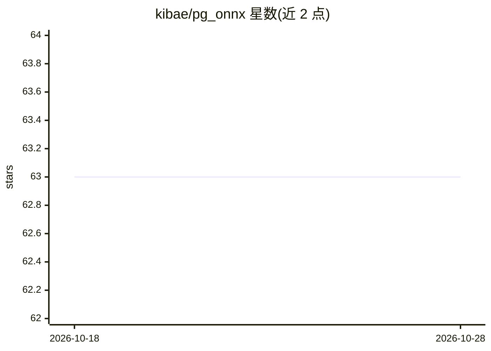

# kibae/pg_onnx

⭐ 63 · C++ · MIT · 推送 2026-10-27 · [GitHub](https://github.com/kibae/pg_onnx) · 个人维护

**PostgreSQL 扩展：在数据库内用 SQL 运行 ONNX 模型推理**

将 ONNX Runtime 集成进 PostgreSQL 的扩展：提供 SQL 函数导入、管理与执行 ONNX 模型（pg_onnx_import_model / execute_session 等），并支持 onnxruntime-extensions 自定义算子加载。关键机制是以 onnxruntime-server 后台 worker 运行并按 ONNX 文件创建、回收会话，避免每个客户端进程各自跑推理导致内存耗尽。支持 PostgreSQL 13-18（Ubuntu/macOS），从源码编译安装，CUDA GPU 支持为可选项。可用触发器在插入数据时自动写入推理结果。

## 筛选速览

| 维度 | 判定 | 备注 |
|---|---|---|
| AI 角色 | `ai-ecosystem` | LLM/agent 周边工具 |
| 许可风险 | `permissive` | MIT |
| 部署形态 | `None` |  |
| 模型依赖 | — | README 未给出锁定关系 |
| 硬件要求 | — | 无带数字的原话,不猜 |
| 安装摩擦 | `high` | 编译与系统依赖俱全 |
| 成熟度 | — | 结构信号不足 |

## 能力要点

- SQL 函数体系：模型导入/删除/列举与会话创建/执行/销毁
- 后台 worker 统一管理 onnxruntime 会话并回收，避免每进程推理的内存问题
- 支持 onnxruntime-extensions 自定义算子库加载（cuda/extensions/session_options 选项）
- 支持 BEFORE INSERT 触发器将推理结果写入列

## 适用场景

- 直接在 SQL 查询中对库内数据做 ML 推理，无需导出到外部服务
- 用触发器在数据写入时自动填充模型输出列
- 在数据库中运行依赖 onnxruntime-extensions 自定义算子的模型

## 场景标签

`推理引擎` · 领域:训练与推理

## 证据(README 行号)

> L7: - **ONNX Runtime integrated with PostgreSQL. Perform ML inference with data in your database.**
> L9:  run out of memory. pg_onnx runs **onnxruntime-server** as a background

## 星数曲线

2026-10-18 63 → 2026-10-28 63（+0）

---
*卡片 v1 · prompt 1.4 · 生成 2026-10-24 · 置信度 high · 依据 README sha `6e8ddbc66629` · [字段定义](../../DATASET.md)*
