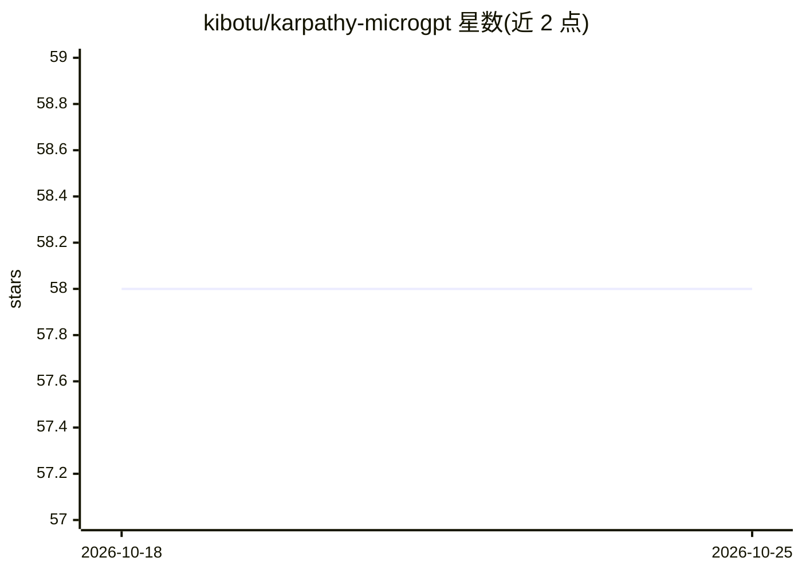

# kibotu/karpathy-microgpt

⭐ 59 · Python · 推送 2026-02-12 · [GitHub](https://github.com/kibotu/karpathy-microgpt) · 个人维护

**243 行无依赖 Python 从零实现并训练 GPT 的教学项目**

基于 Andrej Karpathy 的 microgpt，用纯 Python（仅 import math）从零实现字符级 GPT：手写 Value 类自动微分引擎、多头自注意力（含 KV cache）、RMSNorm、ReLU² MLP 与 Adam 优化器。模型约 4k 参数、单层，在 3.2 万个人名数据集上训练 500 步后生成人名样式的字符序列。运行 ./train.sh 即可（脚本自动安装 uv），无需 GPU，数分钟完成。README 逐步讲解代码执行流程，供理解 GPT 原理。

## 筛选速览

| 维度 | 判定 | 备注 |
|---|---|---|
| AI 角色 | `ai-native` | 本体是模型或模型工具 |
| 许可风险 | `none` | — |
| 部署形态 | `None` |  |
| 模型依赖 | — | README 未给出锁定关系 |
| 硬件要求 | `cpu-ok` | |
| 安装摩擦 | `medium` | 含编译或系统依赖之一 |
| 成熟度 | — | 结构信号不足 |

## 能力要点

- 243 行纯 Python，无 PyTorch/NumPy 依赖
- 手写 autograd、多头注意力、KV cache 与 Adam 优化器
- ./train.sh 一键训练，无需 GPU
- 支持调参（层数/温度/数据集替换）与 PyPy 加速

## 适用场景

- 通过阅读可完整运行的最小实现理解 GPT 工作原理
- 教学场景演示自动微分、注意力与训练循环
- 替换数据集实验字符级语言模型生成

## 场景标签

`教程课程` · 领域:学习与行业

## 证据(README 行号)

> L3: A GPT trained and run in **243 lines of pure, dependency-free Python**. No PyTorch. No NumPy. No nothing. Just `impo
> L17: ./train.sh
> L83: ### 7. Generate names

## 星数曲线

2026-10-18 58 → 2026-10-25 58（+0）

---
*卡片 v1 · prompt 1.4 · 生成 2026-10-24 · 置信度 high · 依据 README sha `22df3c877e66` · [字段定义](../../DATASET.md)*
