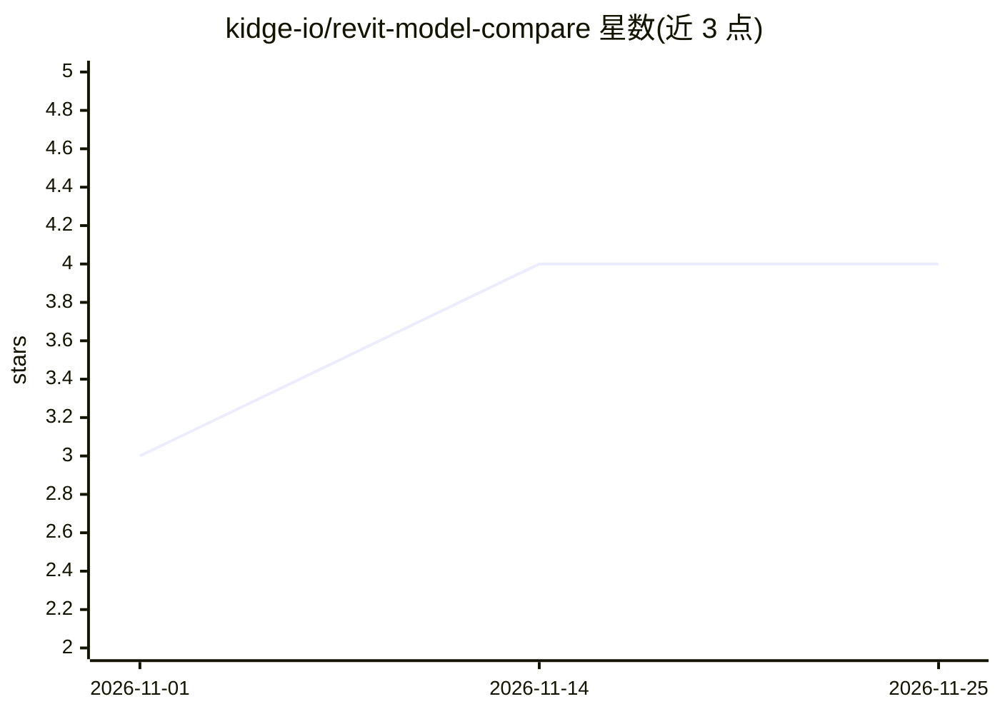

# kidge-io/revit-model-compare

⭐ 4 · Python · MIT · 推送 2026-10-29 · [GitHub](https://github.com/kidge-io/revit-model-compare) · 组织维护 · 中文 README

**用几何匹配衡量 AI/插件生成的 Revit MEP 模型与参考模型的差异**

pyRevit 扩展，提供三个按钮：导出 MEP 元素到 CSV（ID、系统、尺寸、坐标）、按几何匹配对比参考与被测 CSV、为问题簇生成带剖面框的彩色 3D 截图。匹配按端点（管线段）与插入点（构件）进行，输出 Match/Minor offset/Moved/Size mismatch 等 8 类判定及中心线覆盖率指标。依赖 Revit（2024 开发测试）与 pyRevit 7.0，要求两模型共享内部原点，容差固定（5 mm/50 mm/1 m），目前仅在一个真实风管项目与合成样本上验证过。

## 筛选速览

| 维度 | 判定 | 备注 |
|---|---|---|
| AI 角色 | `ai-enhanced` | 去掉 AI 部分产品仍成立 |
| 许可风险 | `permissive` | MIT |
| 部署形态 | `desktop` | 安装包/桌面程序 |
| 模型依赖 | — | README 未给出锁定关系 |
| 硬件要求 | — | 无带数字的原话,不猜 |
| 安装摩擦 | `low` | 无编译、无系统依赖或容器化 |
| 成熟度 | — | 结构信号不足 |

## 能力要点

- 按几何而非元素 ID 匹配，支持两个独立建模的文件对比
- 输出中心线覆盖率作为布管是否到位的单一指标
- Issues.csv 保留双方 ElementId，可在 Revit 中 Select by ID 定位
- 对比核心为纯 Python，可在无 Revit 环境下用 CPython 3 跑单元测试

## 适用场景

- 验收 AI 从 2D 图纸生成的 MEP 模型是否还原参考模型
- 检查插件自动生成的风管/管道系统错在哪、错多少
- 比对业主模型与施工方独立建模的差异并出报告截图

## 场景标签

 · 领域:建筑/工程设计工具

## 证据(README 行号)

> L3: **Measure how accurately an AI- or plugin-generated MEP model reproduces a reference model.**
> L11: Revit Model Compare matches elements **by geometry** instead. It tells you, for every duct, pipe, cable tray and co
> L112: Revit Model Compare is free and MIT-licensed, built by KIDGE Ltd. (Taipei).

## 星数曲线

2026-11-01 3 → 2026-11-25 4（+1）

---
*卡片 v1 · prompt 1.4 · 生成 2026-11-21 · 置信度 mid · 依据 README sha `d273abd08c0d` · [字段定义](../../DATASET.md)*
