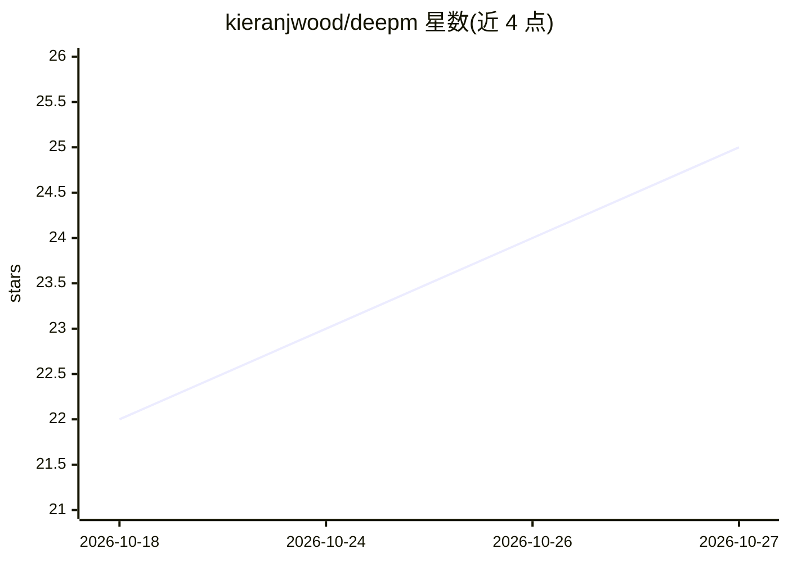

# kieranjwood/deepm

⭐ 25 · Python · MIT · 推送 2026-03-19 · [GitHub](https://github.com/kieranjwood/deepm) · 组织维护

**复现论文的宏观期货组合管理深度学习模型代码**

DeePM 论文的官方代码库，提供端到端训练的深度学习宏观组合管理器：用 Directed Delay（Causal Sieve）机制处理异步 ragged filtration，用宏观经济图先验正则化跨资产依赖，以平滑最差窗口惩罚作为 EVaR 的可微代理做分布鲁棒优化。面向可获取自备期货日线数据的科研用户复现 2010–2025 年 50 个期货合约的回测实验。需 Python≥3.10 与 CUDA GPU，训练依赖 wandb（可离线模式），原始数据因许可限制需自行从 Bloomberg/Refinitiv 等来源获取。

## 筛选速览

| 维度 | 判定 | 备注 |
|---|---|---|
| AI 角色 | `ai-native` | 本体是模型或模型工具 |
| 许可风险 | `permissive` | MIT |
| 部署形态 | `None` |  |
| 模型依赖 | — | README 未给出锁定关系 |
| 硬件要求 | — | 无带数字的原话,不猜 |
| 安装摩擦 | `medium` | 含编译或系统依赖之一 |
| 成熟度 | — | 结构信号不足 |

## 能力要点

- Directed Delay（Causal Sieve）机制处理异步 ragged filtration
- 宏观经济图先验（GNN 邻接矩阵）正则化跨资产依赖
- 最差窗口惩罚作为 EVaR 可微代理的分布鲁棒目标
- 提供 reproduce.sh 全流程脚本与 smoke_test.sh 端到端检查

## 适用场景

- 复现论文中 50 个期货的回测与消融实验
- 在自备期货日线数据上训练 DeePM 组合管理模型
- 对比 Momentum Transformer 等时序基线

## 场景标签

 · 领域:量化金融/组合管理

## 证据(README 行号)

> L11: > We propose DeePM (Deep Portfolio Manager), a structured deep-learning macro portfolio manager trained end-to-end 
> L293: **3. Train models**

## 星数曲线

2026-10-18 22 → 2026-10-27 25（+3）

---
*卡片 v1 · prompt 1.4 · 生成 2026-10-27 · 置信度 high · 依据 README sha `4aca8f4b68f0` · [字段定义](../../DATASET.md)*
