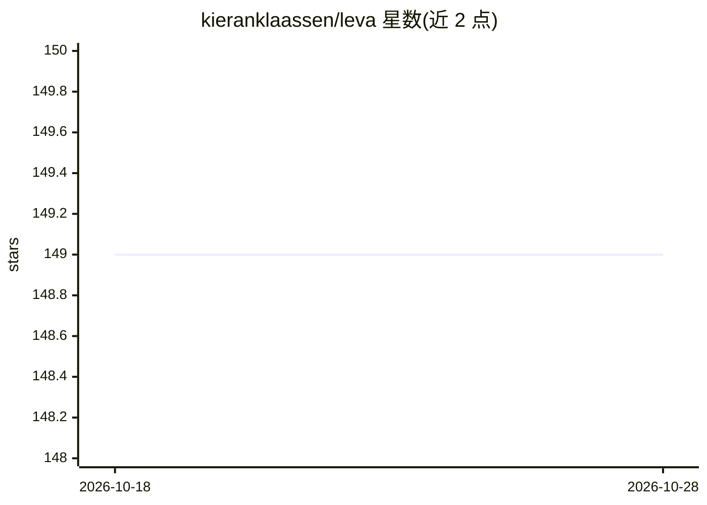

# kieranklaassen/leva

⭐ 149 · Ruby · MIT · 推送 2026-09-13 · [GitHub](https://github.com/kieranklaassen/leva) · 个人维护

**Rails 应用中基于生产数据评估 LLM 的框架**

Ruby on Rails 引擎形式的 LLM 评测框架：以 ActiveRecord 记录构建数据集，通过生成器编写 Run（模型执行逻辑）与 Eval（评分逻辑），创建实验并汇总平均分，内置 Web UI（挂载于 /leva）。支持 Prompt 版本管理与实验绑定，集成 DSPy.rb 做提示词自动优化（Bootstrap/GEPA/MIPROv2，要求 Ruby 3.3+），并可经 Together AI 对 Qwen3 做 LoRA 微调后注册为可评测模型。注意微调会将训练数据上传至第三方。

## 筛选速览

| 维度 | 判定 | 备注 |
|---|---|---|
| AI 角色 | `ai-ecosystem` | LLM/agent 周边工具 |
| 许可风险 | `permissive` | MIT |
| 部署形态 | `None` |  |
| 模型依赖 | locked-api |  |
| 硬件要求 | — | 无带数字的原话,不猜 |
| 安装摩擦 | `low` | 无编译、无系统依赖或容器化 |
| 成熟度 | — | 结构信号不足 |

## 能力要点

- ActiveRecord 数据集驱动的 Run/Eval/Experiment 评测结构，挂载即得 Web UI
- DSPy.rb 集成自动优化提示词与 few-shot 样例（三档模式：light/medium/heavy）
- Together AI LoRA 微调并将结果注册回模型列表（≥10 条记录可触发）
- 细粒度权限：可配置允许触发微调的角色与 overlay 存储位置

## 适用场景

- 在 Rails 生产应用内对 LLM 输出做准确率等评测实验
- 自动搜索适合自有数据集的最优提示词
- 在自有数据上微调 Qwen3 并与其他模型同流程对比评测

## 场景标签

`模型评测` `提示工程` `微调` · 领域:Agent 开发

## 证据(README 行号)

> L6: Leva is a Ruby on Rails framework for evaluating Language Models (LLMs) using ActiveRecord datasets on production mo
> L221: - `Leva`: Handles the process of running experiments.

## 星数曲线

2026-10-18 149 → 2026-10-28 149（+0）

---
*卡片 v1 · prompt 1.4 · 生成 2026-10-23 · 置信度 high · 依据 README sha `f546af2326e9` · [字段定义](../../DATASET.md)*
