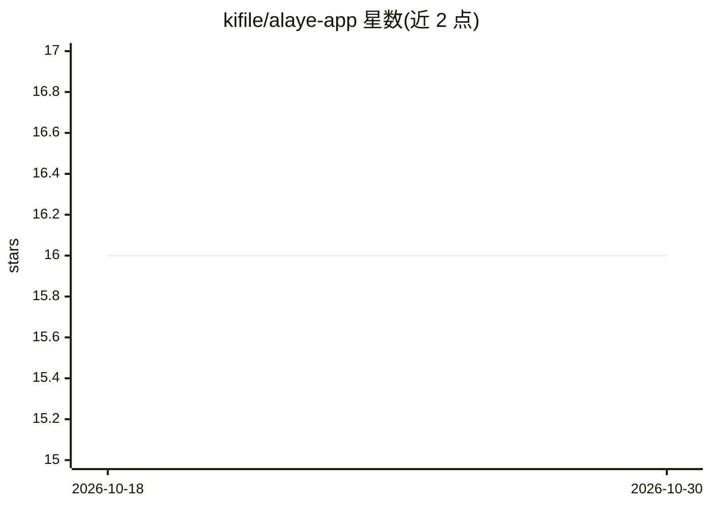

# kifile/alaye-app

⭐ 16 · Python · MIT · 推送 2026-02-02 · [GitHub](https://github.com/kifile/alaye-app) · 个人维护 · 中文 README

**管理 Claude Code 项目配置的跨平台桌面客户端**

面向开发者的 AI 工具桌面管理助手：扫描、配置和管理多个 Claude AI 项目，支持 Claude 插件市场、MCP server 配置与 Hooks 管理。技术栈为 Next.js 16 + React 19 前端与 Python 3.12 + PyWebView 后端，支持 Windows/macOS/Linux。需从源码运行：克隆仓库后用 uv 安装依赖，配置 .env，分别启动前后端；可打包为独立可执行文件。计划中的 v1.0 将扩展 CodeX、Gemini 等多工具支持（尚未实现）。

## 筛选速览

| 维度 | 判定 | 备注 |
|---|---|---|
| AI 角色 | `ai-ecosystem` | LLM/agent 周边工具 |
| 许可风险 | `permissive` | MIT |
| 部署形态 | `library` | 以包/库形式分发 |
| 模型依赖 | locked-api |  |
| 硬件要求 | — | 无带数字的原话,不猜 |
| 安装摩擦 | `low` | 无编译、无系统依赖或容器化 |
| 成熟度 | `idea` | |

## 能力要点

- Claude 项目扫描、设置与多项目管理
- 插件市场、MCP server 配置与 Hooks 管理
- 跨平台桌面应用，可打包为独立可执行文件

## 适用场景

- 统一管理多个 Claude Code 项目的配置
- 在图形界面中配置 MCP server 与 Hooks
- 浏览并安装 Claude 插件

## 场景标签

 · 领域:开发者工具/AI 工作流管理

## 证据(README 行号)

> L9: Alaye App is a desktop management assistant for AI tools, designed to provide developers with a unified and convenie
> L19: - **Claude AI Project Management**: Easily scan, configure, and manage multiple Claude AI projects
> L20: - **Plugin & Extension Support**: Support for Claude plugin marketplace, MCP server configuration, and Hooks manage

## 星数曲线

2026-10-18 16 → 2026-10-30 16（+0）

---
*卡片 v1 · prompt 1.4 · 生成 2026-10-30 · 置信度 mid · 依据 README sha `f13ebd0da314` · [字段定义](../../DATASET.md)*
