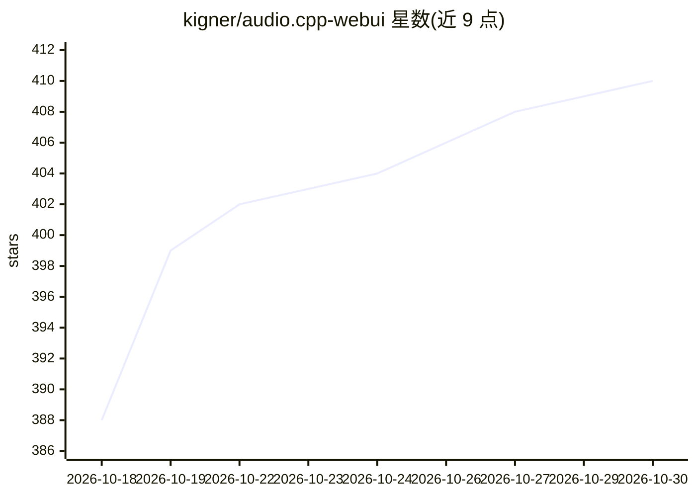

# kigner/audio.cpp-webui

⭐ 410 · C++ · NOASSERTION · 推送 2026-10-24 · [GitHub](https://github.com/kigner/audio.cpp-webui) · 个人维护 · 中文 README

**本地音频模型一体化工作台：TTS/ASR/配音/音乐生成**

Aixora Audio 将本地音频模型集中到一个 WebUI 工作台：语音合成与克隆、语音识别与字幕、视频翻译配音、实时语音对话、全局听写、音乐音效生成、人声分离与降噪等。音频模型通过纯 C++（ggml）后端在本地推理，无需 Python 依赖即可运行模型；对话与翻译可接入用户配置的本地或云端语言模型。提供 Windows 便携包（含 Python 与运行时依赖），后端按 CUDA→Vulkan→CPU 自动选择；也可从源码编译（Windows/Linux，CMake+Ninja）。模型中心收录 113 个模型族、157 个模型条目。

## 筛选速览

| 维度 | 判定 | 备注 |
|---|---|---|
| AI 角色 | `ai-native` | 本体是模型或模型工具 |
| 许可风险 | `none` | NOASSERTION |
| 部署形态 | `desktop` | 安装包/桌面程序 |
| 模型依赖 | — | README 未给出锁定关系 |
| 硬件要求 | `cpu-ok` | |
| 安装摩擦 | `high` | 编译与系统依赖俱全 |
| 成熟度 | — | 结构信号不足 |

## 能力要点

- C++（ggml）本地音频推理后端，无 Python 依赖
- 覆盖 TTS、ASR/字幕、视频配音、实时语音、听写、音乐生成、人声分离
- Windows 便携包开箱即用，后端 CUDA/Vulkan/CPU 自动选择
- 模型中心收录 113 个模型族、157 个模型条目

## 适用场景

- 在本地把文字转成配音、把录音转成带时间戳的字幕
- 给视频做翻译配音并保留背景音乐
- 通过麦克风与选定的角色语音进行实时对话
- 用快捷键在其他应用中全局听写

## 场景标签

`语音合成` `语音识别` `语音 Agent` · 领域:对话与助手

## 证据(README 行号)

> L22: Aixora Audio brings local audio models into one workspace. Turn text into voiceovers, transcribe recordings into su
> L30: |Speech synthesis and voice cloning|Enter text, choose a preset voice or reference recording, generate and listen; 
> L35: |Music, sound effects and voice design|Generate audio from prompts or lyrics, describe a voice, or convert speech a

## 星数曲线

2026-10-18 388 → 2026-10-30 410（+22）

---
*卡片 v1 · prompt 1.4 · 生成 2026-10-21 · 置信度 mid · 依据 README sha `a70de99b52ea` · [字段定义](../../DATASET.md)*
