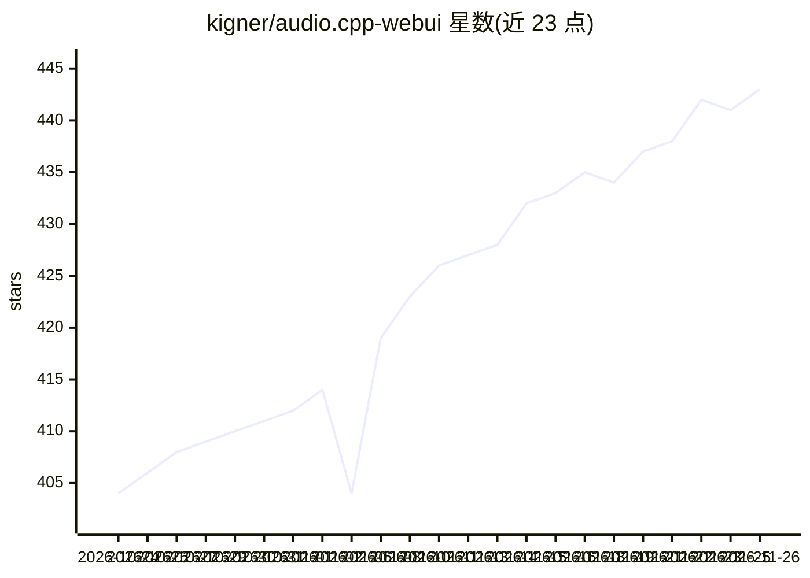

# kigner/audio.cpp-webui

⭐ 443 · C++ · NOASSERTION · 推送 2026-11-05 · [GitHub](https://github.com/kigner/audio.cpp-webui) · 个人维护 · 中文 README

**本地音频模型工作台：文字转语音、语音识别、视频翻译配音等**

基于 C++（ggml）音频推理引擎的本地工作台，将语音合成与克隆、语音识别与字幕、视频翻译配音、实时语音对话、同传、全局听写、音乐与音效生成、人声分离降噪等任务集成在一个 WebUI 中。提供 Windows 便携包（内置 Python 与运行时），也可从源码编译 C++ 后端（CUDA/Vulkan/CPU 三种后端）并配置 Python 3.11 环境运行；对话与翻译可连接本地或云端语言模型。

## 筛选速览

| 维度 | 判定 | 备注 |
|---|---|---|
| AI 角色 | `ai-native` | 本体是模型或模型工具 |
| 许可风险 | `none` | NOASSERTION |
| 部署形态 | `desktop` | 安装包/桌面程序 |
| 模型依赖 | — | README 未给出锁定关系 |
| 硬件要求 | `cpu-ok` | |
| 安装摩擦 | `high` | 编译与系统依赖俱全 |
| 成熟度 | — | 结构信号不足 |

## 能力要点

- 覆盖 TTS、语音克隆、ASR/字幕、VAD、变声、说话人分离、音乐生成等音频任务
- C++ 后端本地推理，支持 CUDA/Vulkan/CPU 后端自动选择或手动指定
- 实时语音对话支持同一 Wi-Fi 下手机扫码接入，同传可输出 24 kHz WAV
- 便携包通过 update.bat 更新，保留模型、音色与设置

## 适用场景

- 把文字稿转成配音并导出字幕
- 给视频做翻译配音并保留背景音乐
- 本地跑语音对话或给其他应用做全局听写
- 下载和管理本地音频模型与参考音频

## 场景标签

`语音 Agent` `语音合成` `语音识别` · 领域:对话与助手

## 证据(README 行号)

> L22: Aixora Audio brings local audio models into one workspace. Turn text into voiceovers, transcribe recordings into su
> L30: |Speech synthesis and voice cloning|Enter text, choose a preset voice or reference recording, generate and listen; 
> L52: The portable package includes Python and runtime dependencies. The launcher selects an available backend in **CUDA 

## 星数曲线

2026-10-24 404 → 2026-11-26 443（+39）

---
*卡片 v1 · prompt 1.4 · 生成 2026-11-25 · 置信度 mid · 依据 README sha `a78c24d5039a` · [字段定义](../../DATASET.md)*
