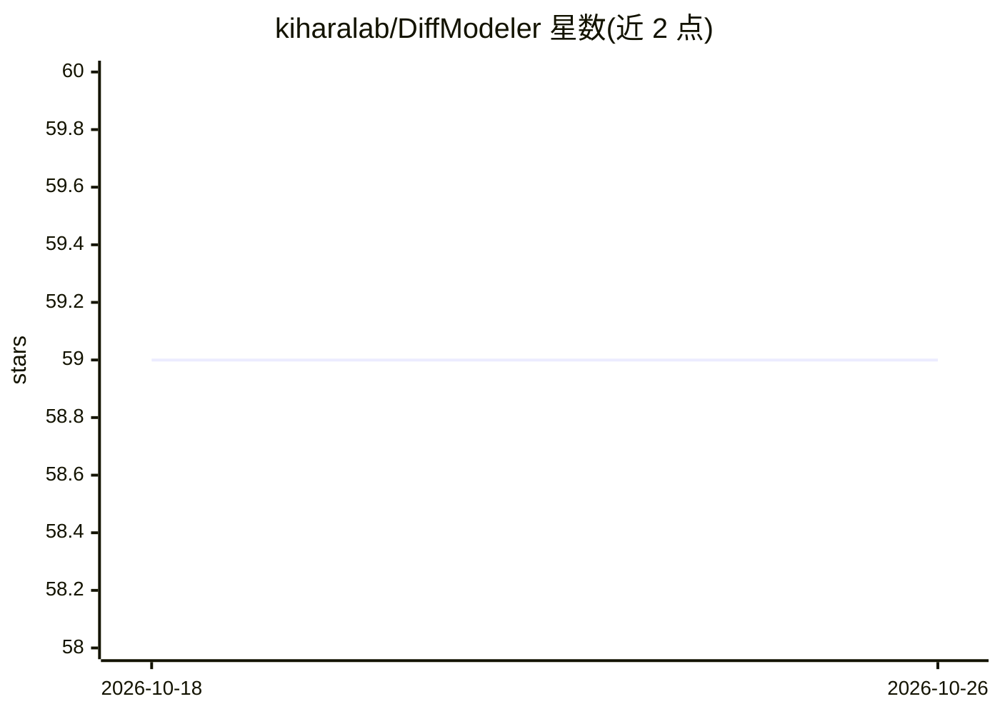

# kiharalab/DiffModeler

⭐ 59 · Python · 推送 2026-01-12 · [GitHub](https://github.com/kiharalab/DiffModeler) · [官网](https://em.kiharalab.org/algorithm/DiffModeler) · 组织维护

**从 cryo-EM 密度图自动构建蛋白质复合物结构的扩散模型工具**

面向结构生物学科研用户：输入 0-20Å 分辨率的 cryo-EM 密度图，配合单链结构模板（可来自 AlphaFold）或序列，通过扩散模型进行主干追踪（backbone tracing），再用 VESPER 拟合与组装算法生成全复合物结构，输出 cif 文件并在 occupancy 字段记录拟合得分。提供两种输入模式（模板/序列）及基于结构域的建模选项，另设免费在线服务器。GPU 为必需硬件（最低 12GB 显存），通过 conda 或 pixi 配置环境并从 Hugging Face 下载预训练权重。GPL v3 许可，商业许可需联系作者。

## 筛选速览

| 维度 | 判定 | 备注 |
|---|---|---|
| AI 角色 | `ai-native` | 本体是模型或模型工具 |
| 许可风险 | `none` | — |
| 部署形态 | `None` |  |
| 模型依赖 | — | README 未给出锁定关系 |
| 硬件要求 | — | 无带数字的原话,不猜 |
| 安装摩擦 | `medium` | 含编译或系统依赖之一 |
| 成熟度 | — | 结构信号不足 |

## 能力要点

- 扩散模型从中间分辨率 cryo-EM 图进行主干追踪
- 支持模板（AlphaFold 预测单链）与序列（EBI 检索）两种输入模式
- 支持 SWORD2 基于结构域的复合物建模
- 提供免费在线服务器（含蛋白质-DNA 复合物建模入口）

## 适用场景

- 从 5-10Å 中间分辨率 cryo-EM 图自动搭建多链蛋白复合物模型
- 仅有密度图和序列时检索模板并建模复合物
- 对低分辨率（10-20Å）图谱进行复合物结构预测

## 场景标签

`科研工具` · 领域:学习与行业

## 证据(README 行号)

> L6: DiffModeler is a computational tool using a diffusion model to automatically build full protein complex structure fr
> L41: method that leverages a diffusion model for backbone tracing and structure fitting with AlphaFold predicted single-

## 星数曲线

2026-10-18 59 → 2026-10-26 59（+0）

---
*卡片 v1 · prompt 1.4 · 生成 2026-10-24 · 置信度 high · 依据 README sha `c5f71202d689` · [字段定义](../../DATASET.md)*
