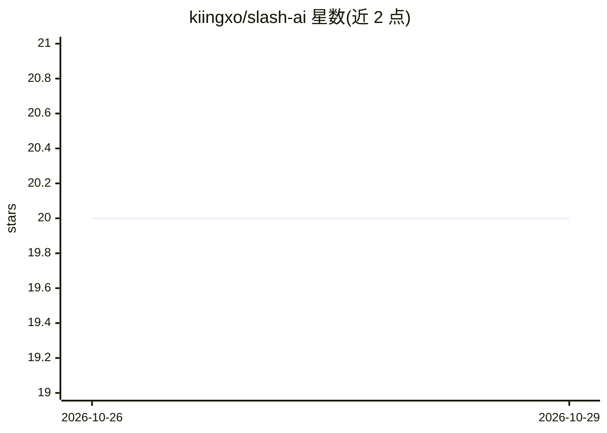

# kiingxo/slash-ai

⭐ 20 · Dart · MIT · 推送 2026-06-15 · [GitHub](https://github.com/kiingxo/slash-ai) · [官网](https://useslash.dev/) · 个人维护

**移动端 AI 工作区：GitHub 变更开发与 VPS 运维一站处理**

基于 Flutter 的移动优先应用，面向开发者的 GitHub 工作流与 VPS 运维工具：Prompt 模块提供仓库感知的 AI 对话以规划变更、生成编辑草案并自动开 PR；Code 模块为带语法高亮的手动编辑器，可请求 AI 定向修改与审查；Project 模块生成 24h/7d 仓库健康摘要并导出 PDF；Ops 模块通过 SSH 查看 VPS 指标、Docker 容器、systemd 服务并执行终端命令。AI 提供方支持 OpenAI 与 OpenRouter，凭据经 flutter_secure_storage 本地存储；Ops 不支持 Flutter Web。需 Flutter SDK 从源码运行。

## 筛选速览

| 维度 | 判定 | 备注 |
|---|---|---|
| AI 角色 | `ai-native` | 本体是模型或模型工具 |
| 许可风险 | `permissive` | MIT |
| 部署形态 | `None` |  |
| 模型依赖 | locked-api |  |
| 硬件要求 | — | 无带数字的原话,不猜 |
| 安装摩擦 | `low` | 无编译、无系统依赖或容器化 |
| 成熟度 | — | 结构信号不足 |

## 能力要点

- 仓库感知 AI 对话：生成变更草案、审查 diff、批准后自动开 PR
- SSH 连接查看 CPU/内存/磁盘趋势、Docker 容器、systemd 服务并执行终端命令
- 生成 24h/7d 仓库健康摘要（摘要/风险/行动项）并导出 PDF
- PR 收件箱：过滤、搜索、评论、批准与请求修改

## 适用场景

- 在手机上让 AI 生成代码变更并直接开出 PR
- 移动端浏览仓库健康状态并导出 PDF 摘要
- 随时 SSH 连接 VPS 查看容器与服务的实时状态
- 在移动端审查、评论和批准 pull request

## 场景标签

`代码审查` `编码 Agent` · 领域:编码与开发

## 证据(README 行号)

> L3: /slash is a Flutter app for shipping GitHub changes and watching live VPS runtime state from one place.
> L9: - `Prompt`: repo-aware AI chat for planning changes, generating edits, and reviewing proposed diffs
> L62: - AI providers supported today: `OpenAI` and `OpenRouter`

## 星数曲线

2026-10-26 20 → 2026-10-29 20（+0）

---
*卡片 v1 · prompt 1.4 · 生成 2026-10-28 · 置信度 high · 依据 README sha `d46ecc9f7373` · [字段定义](../../DATASET.md)*
