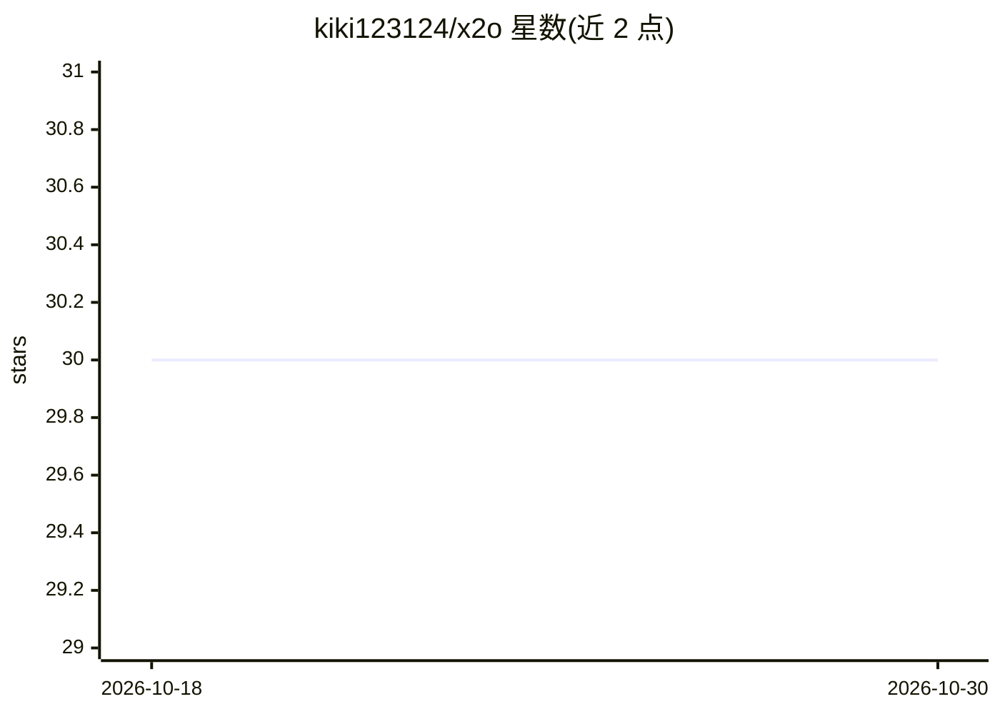

# kiki123124/x2o

⭐ 30 · TypeScript · MIT · 推送 2026-03-23 · [GitHub](https://github.com/kiki123124/x2o) · [官网](https://github.com/kiki123124/x2o#readme) · 个人维护 · 中文 README

**将 X (Twitter) 书签导出并经 AI 分类生成 Obsidian 知识库的桌面/CLI 工具**

面向个人知识管理用户：粘贴浏览器 Cookie 后自动拉取全部 X (Twitter) 书签（含长推文与 t.co 短链接解析），再由 19+ AI 服务商（含 Ollama 本地模型与 Claude Code/OpenClaw 宿主 AI 的免 API key 模式）自动归类并生成中文摘要，最终按分类输出 Markdown 文件构成 Obsidian 知识库。数据全程本地处理，不经过第三方服务器。桌面端基于 Tauri 2 + Rust + SolidJS，提供 macOS Apple Silicon 的 .dmg 安装包，也可用 CLI（npx tsx）或作为 Claude Code/OpenClaw 的 CLI Skill 安装。

## 筛选速览

| 维度 | 判定 | 备注 |
|---|---|---|
| AI 角色 | `ai-enhanced` | 去掉 AI 部分产品仍成立 |
| 许可风险 | `permissive` | MIT |
| 部署形态 | `desktop` | 安装包/桌面程序 |
| 模型依赖 | local-ok | 支持本地模型 |
| 硬件要求 | — | 无带数字的原话,不猜 |
| 安装摩擦 | `low` | 无编译、无系统依赖或容器化 |
| 成熟度 | — | 结构信号不足 |

## 能力要点

- 19+ AI 服务商分类，含 host 模式（宿主 AI 直接分类，无需 API key）与 Ollama 本地模型
- 一键抓取 X 书签，支持长推文完整抓取与 t.co 短链接还原
- 按分类生成 Markdown 的 Obsidian 知识库，可换模型重新分类而无需重新抓取
- 数据全部本地处理，提供桌面 App（Tauri 2 + Rust）与 CLI 两种形态

## 适用场景

- 把 X 收藏的推文沉淀为可检索的 Obsidian 知识库
- 换不同 AI 模型对已抓取的书签重新分类
- 在 Claude Code/OpenClaw 中通过一句话触发书签导出与分类

## 场景标签

`知识库管理` `网页抓取` · 领域:效率与自动化

## 证据(README 行号)

> L11: Export your X (Twitter) bookmarks, classify them with 19+ AI providers (including local models via Ollama and API-f
> L18: - **Obsidian 知识库** — 按分类生成 Markdown 文件，直接用 Obsidian 打开
> L23: - **桌面 App + CLI** — 图形界面或命令行，随你选

## 星数曲线

2026-10-18 30 → 2026-10-30 30（+0）

---
*卡片 v1 · prompt 1.4 · 生成 2026-10-26 · 置信度 high · 依据 README sha `a26427fd7d2d` · [字段定义](../../DATASET.md)*
