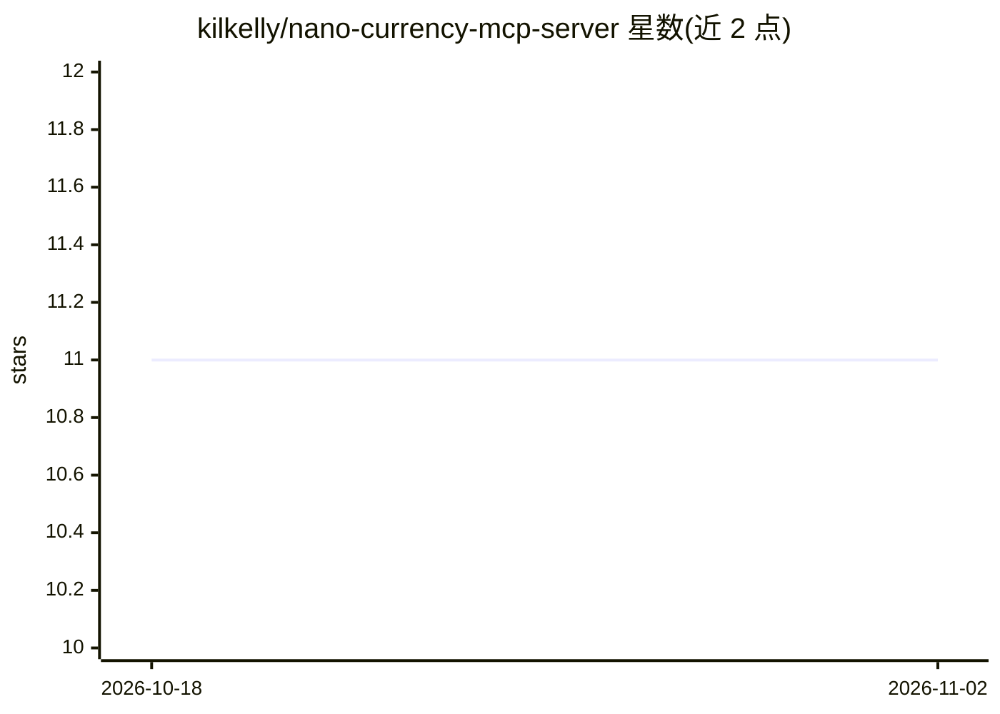

# kilkelly/nano-currency-mcp-server

⭐ 11 · JavaScript · MIT · 推送 2026-02-13 · [GitHub](https://github.com/kilkelly/nano-currency-mcp-server) · 个人维护

**让 AI agent 通过 MCP 发送 Nano 加密货币与查询账户信息的服务器**

一个 MCP（Model Context Protocol）服务器，使 MCP 兼容客户端（含 AI agent）能够通过 Nano 节点 RPC 发送 Nano 货币、查询账户与区块信息，并生成 x402 协议的支付签名头，供 AI agent 以 Nano 为 API/资源付费。提供 6 个工具（raw_send、nano_send、账户/区块查询、x402 签名创建）；通过环境变量配置 RPC 地址与私钥，默认单笔发送上限 0.01 nano，可用变量提高上限。需 Node.js/NPM 环境，以 git clone 源码方式安装，并需自备 MCP 客户端连接。

## 筛选速览

| 维度 | 判定 | 备注 |
|---|---|---|
| AI 角色 | `ai-ecosystem` | LLM/agent 周边工具 |
| 许可风险 | `permissive` | MIT |
| 部署形态 | `library` | 以包/库形式分发 |
| 模型依赖 | — | README 未给出锁定关系 |
| 硬件要求 | — | 无带数字的原话,不猜 |
| 安装摩擦 | `low` | 无编译、无系统依赖或容器化 |
| 成熟度 | — | 结构信号不足 |

## 能力要点

- raw_send/nano_send 从预定义账户发送 Nano 转账
- 查询账户余额、代表、frontier 区块及区块详情
- 生成 x402 PAYMENT-SIGNATURE 头，支持以 Nano 支付 API/资源
- 默认 0.01 nano 单笔发送上限，可用环境变量调整

## 适用场景

- 让 Claude Desktop 等 MCP 客户端中的 AI agent 代为发送 Nano 转账
- AI agent 通过 x402 协议用 Nano 支付 API 调用费用
- 在 agent 中查询 Nano 账户与区块信息

## 场景标签

 · 领域:加密货币/AI agent 基础设施

## 证据(README 行号)

> L3: `Nano Currency MCP Server` gives MCP-compatible clients (including AI agents) the ability to send Nano currency and 
> L7: `Nano Currency MCP Server` also allows for the creation of x402-compatible headers, giving AI agents the ability to 

## 星数曲线

2026-10-18 11 → 2026-11-02 11（+0）

---
*卡片 v1 · prompt 1.4 · 生成 2026-11-02 · 置信度 high · 依据 README sha `10fe63619b55` · [字段定义](../../DATASET.md)*
