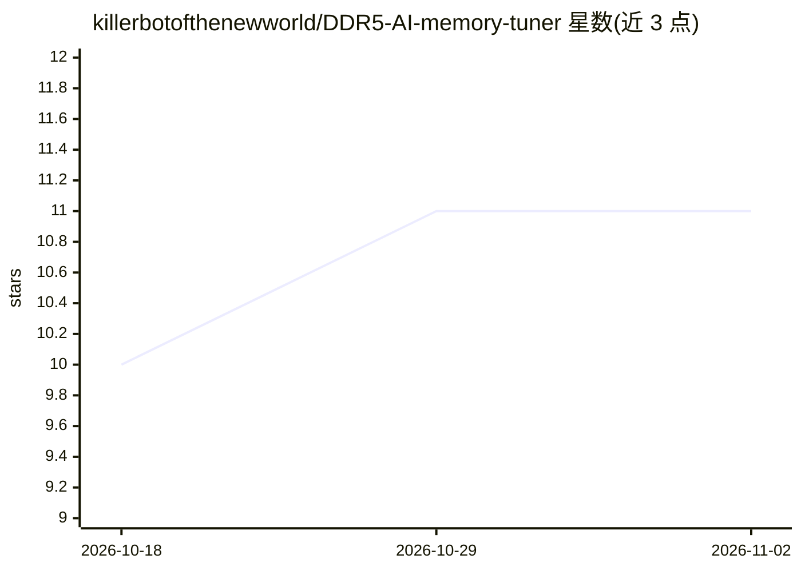

# killerbotofthenewworld/DDR5-AI-memory-tuner

⭐ 11 · Python · MIT · 推送 2026-04-16 · [GitHub](https://github.com/killerbotofthenewworld/DDR5-AI-memory-tuner) · 个人维护

**面向内存超频玩家的 DDR5 时序调优与性能模拟器（AI 优化）**

DDR5 内存调优工具：提供 Streamlit Web 界面，支持手动参数模拟、JEDEC 合规校验，以及遗传算法、神经网络、强化学习等多种 AI 引擎自动优化时序，并集成 Optuna AutoML 流程。支持真实硬件实时调节（带安全锁、参数备份与紧急恢复），可导入 ASUS AI Suite、MSI Dragon Center、Intel XTU 配置。Windows 提供 EXE 安装包，其他平台从源码运行；实时调参需管理员权限。LLM 集成列为功能之一（OpenAI/Anthropic/Ollama 等）。

## 筛选速览

| 维度 | 判定 | 备注 |
|---|---|---|
| AI 角色 | `ai-native` | 本体是模型或模型工具 |
| 许可风险 | `permissive` | MIT |
| 部署形态 | `desktop` | 安装包/桌面程序 |
| 模型依赖 | — | README 未给出锁定关系 |
| 硬件要求 | — | 无带数字的原话,不猜 |
| 安装摩擦 | `low` | 无编译、无系统依赖或容器化 |
| 成熟度 | — | 结构信号不足 |

## 能力要点

- 多种 AI 优化引擎（遗传算法/神经网络/RL）与 Optuna AutoML 流程
- JEDEC 合规校验与电压/时序安全限制、参数备份与紧急恢复
- 真实硬件实时调节与 WebSocket 实时指标监控
- Windows EXE 安装包，源码方式支持全平台

## 适用场景

- 模拟并优化 DDR5 时序参数后再应用到真实硬件
- 校验超频配置是否符合 JEDEC 规范与安全限制
- 导入其他厂商工具（Intel XTU 等）的配置进行对比分析

## 场景标签

 · 领域:硬件调优/超频工具

## 证据(README 行号)

> L8: > DDR5 AI memory tuner for safe timing optimization and performance simulation; Streamlit UI, Windows installer, JED
> L78: - **Multiple AI Engines** - Genetic Algorithm, Neural Networks, RL
> L80: - **LLM Integration** - OpenAI, Anthropic, Ollama, Local models

## 星数曲线

2026-10-18 10 → 2026-11-02 11（+1）

---
*卡片 v1 · prompt 1.4 · 生成 2026-11-02 · 置信度 mid · 依据 README sha `fb32c8eb4aef` · [字段定义](../../DATASET.md)*
