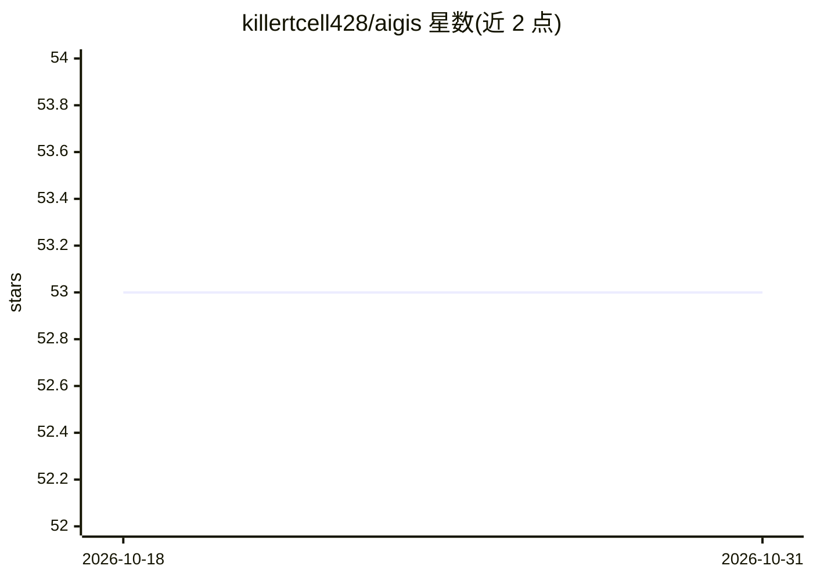

# killertcell428/aigis

⭐ 53 · Python · Apache-2.0 · 推送 2026-10-25 · [GitHub](https://github.com/killertcell428/aigis) · [官网](https://pypi.org/project/pyaigis/) · 个人维护 · 中文 README

**给 AI agent 工具调用加策略护栏与防篡改审计日志的 Python OSS**

面向在企业内推进 Claude Code 等 AI agent 合规落地的开发者和安全团队：通过 PreToolUse hooks 在每个 Bash/Edit/Write/WebFetch 执行前做确定性策略扫描（模式、相似度、结构分析，无 LLM judge），拒绝动作以 exit 2 阻断；审计日志逐行 HMAC-SHA256 签名并哈希链化，可用 aigis audit verify 验证；aigis trust-pack 读取本地配置生成含 ISO 27001/NIST AI RMF/OWASP LLM 对照矩阵的 IT 审批包。以 pip 包提供，另有 Docker sidecar 模式（REST 端点）与角色配置生成器（同时产出 Aigis 策略与 Claude Code 权限文件）。默认 HMAC 密钥与 agent 同机存放，需配合外部密钥与 SIEM 转发增强证据强度。

## 筛选速览

| 维度 | 判定 | 备注 |
|---|---|---|
| AI 角色 | `ai-ecosystem` | LLM/agent 周边工具 |
| 许可风险 | `permissive` | Apache-2.0 |
| 部署形态 | `self-host` | docker 或自建部署 |
| 模型依赖 | locked-api |  |
| 硬件要求 | — | 无带数字的原话,不猜 |
| 安装摩擦 | `low` | 无编译、无系统依赖或容器化 |
| 成熟度 | — | 结构信号不足 |

## 能力要点

- 工具调用执行前的确定性策略扫描，无 LLM judge、API 成本为 0
- HMAC 签名 + 哈希链的只追加审计日志，篡改可检测
- trust-pack 生成含 ISO 27001/NIST AI RMF/OWASP LLM 对照的控制矩阵审批包
- aigis profile build 从 6 值角色文件同时生成 Aigis 策略与 Claude Code 权限配置

## 适用场景

- 让 Claude Code 等编码 agent 通过公司安全审批并留存审计证据
- 按团队角色（如市场/工程）集中生成与下发 agent 权限规则
- 作为 Docker sidecar 或本地网关对任意 HTTP agent 的输入输出做检查

## 场景标签

`网络安全` · 领域:学习与行业

## 证据(README 行号)

> L8:  Aigis scans every tool call against a policy, keeps a tamper-evident audit log, and generates the approval pack you
> L19: `init` wires PreToolUse hooks into Claude Code so every Bash/Edit/Write/WebFetch is scanned *before* it runs, and r
> L89: Endpoints: `POST /v1/check/input` · `POST /v1/check/output` · `POST /v1/check/messages` · `GET /health` · `GET /v1/

## 星数曲线

2026-10-18 53 → 2026-10-31 53（+0）

---
*卡片 v1 · prompt 1.4 · 生成 2026-10-24 · 置信度 mid · 依据 README sha `737e468bd19e` · [字段定义](../../DATASET.md)*
