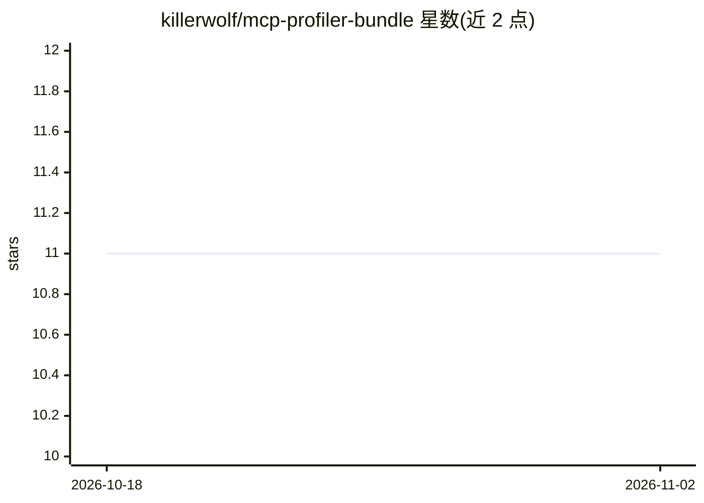

# killerwolf/mcp-profiler-bundle

⭐ 11 · PHP · 推送 2026-09-16 · [GitHub](https://github.com/killerwolf/mcp-profiler-bundle) · 个人维护

**已弃用的 Symfony MCP 服务器：向 AI 编码代理开放 Profiler 数据**

Symfony Bundle，实现 MCP 协议（JSON-RPC），把 Symfony Profiler 数据（请求、查询、计时、收集器）以工具形式暴露给 MCP 客户端（如 IDE 中的 AI 编码代理），提供 profiler_list / profiler_get_by_token 等 4 个内置工具，另有 bin/console 命令行直接查看 Profiler 条目。项目已标记弃用，官方建议改用 Symfony AI Mate（其还支持按 URL/状态/日期过滤、密钥脱敏等）。0.2.1 为最终版本，仓库保留作记录。

## 筛选速览

| 维度 | 判定 | 备注 |
|---|---|---|
| AI 角色 | `ai-ecosystem` | LLM/agent 周边工具 |
| 许可风险 | `none` | — |
| 部署形态 | `library` | 以包/库形式分发 |
| 模型依赖 | — | README 未给出锁定关系 |
| 硬件要求 | — | 无带数字的原话,不猜 |
| 安装摩擦 | `low` | 无编译、无系统依赖或容器化 |
| 成熟度 | — | 结构信号不足 |

## 能力要点

- 实现 MCP 协议（JSON-RPC），向 AI 编码代理暴露 Symfony Profiler 数据
- 内置 4 个 profiler 工具（列出条目、按 token 取条目/收集器）
- 提供 mcp:profiler 命令行直接查看 Profiler 条目
- 已弃用，官方替代为 Symfony AI Mate

## 适用场景

- 让 IDE 中的 AI 编码代理读取 Symfony 请求与查询调试数据
- 通过 MCP Inspector 测试与浏览 Profiler 工具输出
- 新项目应改用官方 Symfony AI Mate 方案

## 场景标签

 · 领域:Web 开发调试/LLM 工具接入

## 证据(README 行号)

> L100: The bundle implements the MCP protocol directly, handling JSON-RPC requests and responses according to the specifi
> L104: 1. A command that runs the MCP server (`mcp:server:run`)

## 星数曲线

2026-10-18 11 → 2026-11-02 11（+0）

---
*卡片 v1 · prompt 1.4 · 生成 2026-11-02 · 置信度 mid · 依据 README sha `f090f1f4b05d` · [字段定义](../../DATASET.md)*
