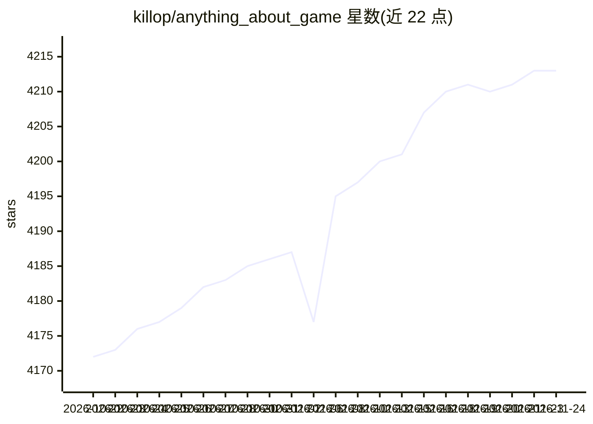

# killop/anything_about_game

⭐ 4,214 · Apache-2.0 · 推送 2026-11-17 · [GitHub](https://github.com/killop/anything_about_game) · 个人维护 · 中文 README

**游戏开发资源聚合清单：为游戏开发者汇集教程、博客与工具链接**

以 Awesome 清单形式组织的游戏开发资源目录，分Awesome-Game、News、Person/Blogs 等板块，收录图形学论文站点、TA/渲染博客、引擎资讯、中文开发者博客列表及各类 awesome 子清单链接；含 QQ 交流群，无安装与运行步骤，内容以链接罗列为主，标注部分资源需自备网络访问。

## 筛选速览

| 维度 | 判定 | 备注 |
|---|---|---|
| AI 角色 | `ai-knowledge` | 知识聚合/清单类 |
| 许可风险 | `permissive` | Apache-2.0 |
| 部署形态 | `None` |  |
| 模型依赖 | — | README 未给出锁定关系 |
| 硬件要求 | — | 无带数字的原话,不猜 |
| 安装摩擦 | `high` | 编译与系统依赖俱全 |
| 成熟度 | — | 结构信号不足 |

## 能力要点

- 收录游戏开发、图形学、TA 技术美工方向的博客与资讯链接
- 包含大量中文游戏开发/Unity/UE 博客作者条目
- 汇集 GDC 视频、论文站点、图形学周刊等学习资源
- 关联多个 awesome 系列子清单（碰撞检测、光线追踪、C++ 等）

## 适用场景

- 系统学习游戏开发与实时渲染时查找资料入口
- 寻找中文游戏开发社区博客与技术周刊
- 查找图形学论文与着色器学习资源

## 场景标签

`精选清单` · 领域:学习与行业

## 证据(README 行号)

> L3:  高端游戏开发资源干货分享QQ群:1067123079 &nbsp &nbsp &nbsp 职场灌水QQ群:894955505
> L5: Table of Contents
> L8: ## Awesome-Game

## 星数曲线

2026-10-22 4,172 → 2026-11-24 4,213（+41）

---
*卡片 v1 · prompt 1.4 · 生成 2026-11-23 · 置信度 high · 依据 README sha `28ed5deabca3` · [字段定义](../../DATASET.md)*
