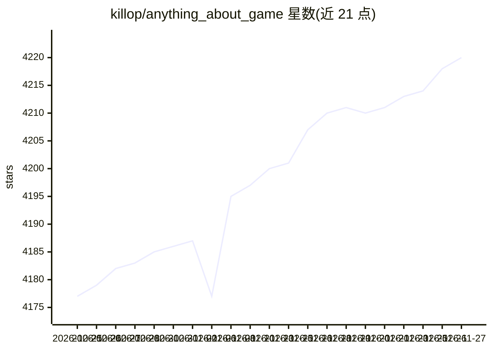

# killop/anything_about_game

⭐ 4,220 · Apache-2.0 · 推送 2026-11-25 · [GitHub](https://github.com/killop/anything_about_game) · 个人维护 · 中文 README

**游戏开发资源聚合清单：为开发者汇集学习与工具链接**

以 awesome-list 形式组织的游戏开发资源索引，收录其他游戏开发清单与导航站、图形学论文与新闻源、CG/硬件资讯站点，以及大量以中文为主的开发者博客（覆盖 Unity/UE 技术美术、管线、网络同步、数学、光线追踪等方向）和英文 TA/图形学博客列表。内容为链接与条目罗列，不包含可安装的软件本体；通过 README 阅读并跳转外部资源。

## 筛选速览

| 维度 | 判定 | 备注 |
|---|---|---|
| AI 角色 | `ai-knowledge` | 知识聚合/清单类 |
| 许可风险 | `permissive` | Apache-2.0 |
| 部署形态 | `None` |  |
| 模型依赖 | — | README 未给出锁定关系 |
| 硬件要求 | — | 无带数字的原话,不猜 |
| 安装摩擦 | `high` | 编译与系统依赖俱全 |
| 成熟度 | — | 结构信号不足 |

## 能力要点

- 汇集数十个游戏开发相关 awesome 清单与导航站
- 收录图形学论文来源与期刊链接（NVIDIA/JCGT 等）
- 整理大量中文与英文技术美术、图形学开发者博客

## 适用场景

- 入门或进阶游戏开发时查找学习资料与路线图
- 查找图形学/技术美术方向的博客与论文来源
- 了解游戏开发领域的开源项目与工具集合入口

## 场景标签

`精选清单` · 领域:学习与行业

## 证据(README 行号)

> L1: anyting_about_game
> L5: Table of Contents
> L40: - awesome-gamedev : A list of Game Development resources to make magic happen.

## 星数曲线

2026-10-25 4,177 → 2026-11-27 4,220（+43）

---
*卡片 v1 · prompt 1.4 · 生成 2026-11-26 · 置信度 high · 依据 README sha `279f8bbfec8c` · [字段定义](../../DATASET.md)*
