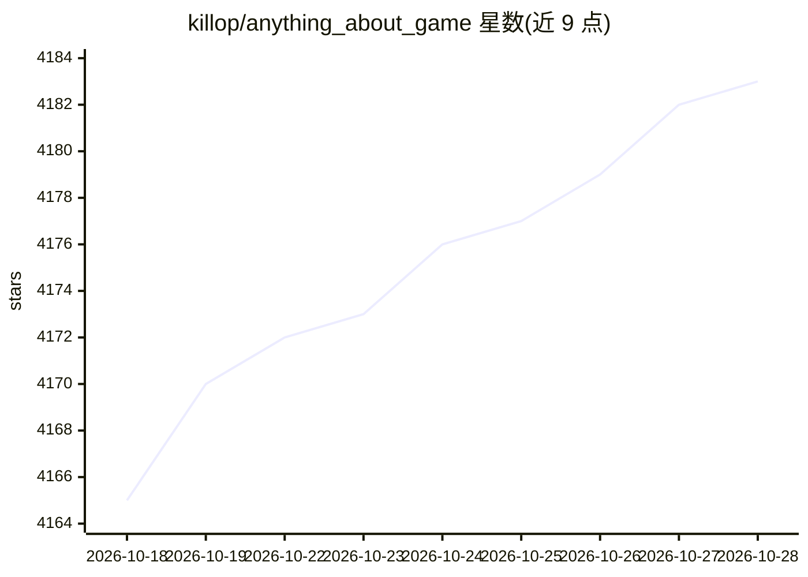

# killop/anything_about_game

⭐ 4,183 · Apache-2.0 · 推送 2026-10-28 · [GitHub](https://github.com/killop/anything_about_game) · 个人维护 · 中文 README

**游戏开发资源聚合清单：收录工具、库、博客与周刊链接**

以 Markdown 清单形式收录游戏开发相关资源，条目覆盖 awesome 类聚合仓库、游戏/图形/CG 资讯与周报站点、中英文个人技术博客（含大量 TA/渲染/Unity/UE 方向博主），以及硬件资讯与论文资源站点。条目多为纯链接，少量附中文注释说明内容方向。README 顶部附 QQ 群号。面向游戏开发者与图形程序员作为资源导航使用，不含可运行代码，主题标签含 ai-agent、ecs 等方向。

## 筛选速览

| 维度 | 判定 | 备注 |
|---|---|---|
| AI 角色 | `ai-knowledge` | 知识聚合/清单类 |
| 许可风险 | `permissive` | Apache-2.0 |
| 部署形态 | `None` |  |
| 模型依赖 | — | README 未给出锁定关系 |
| 硬件要求 | — | 无带数字的原话,不猜 |
| 安装摩擦 | `high` | 编译与系统依赖俱全 |
| 成熟度 | — | 结构信号不足 |

## 能力要点

- 按 Awesome-Game/News/Person 等大类组织数百条资源链接
- 收录大量中英文 TA、渲染、Unity/UE 方向个人博客
- 覆盖图形学论文、周报、CG 与硬件资讯站点

## 适用场景

- 查找游戏开发各方向的工具库与聚合清单
- 按博主方向（TA、管线、网络同步等）发现技术博客
- 追踪图形学与游戏开发方向的周报与论文资源

## 场景标签

`精选清单` · 领域:学习与行业

## 证据(README 行号)

> L8: ## Awesome-Game
> L62: ## Awesome-General
> L183: ## Person/Social/Blogs

## 星数曲线

2026-10-18 4,165 → 2026-10-28 4,183（+18）

---
*卡片 v1 · prompt 1.4 · 生成 2026-10-21 · 置信度 high · 依据 README sha `2b13906bbd42` · [字段定义](../../DATASET.md)*
