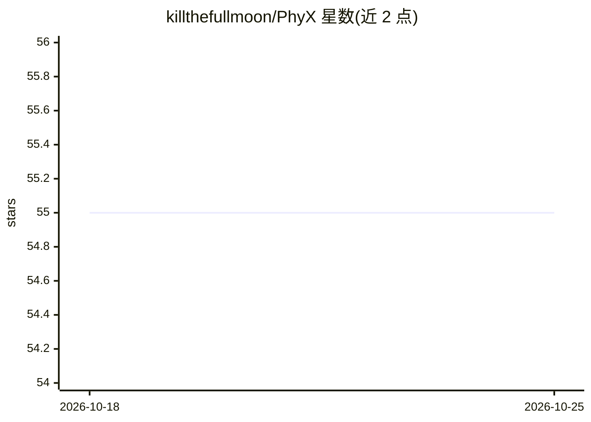

# killthefullmoon/PhyX

⭐ 55 · Python · MIT · 推送 2026-03-16 · [GitHub](https://github.com/killthefullmoon/PhyX) · [官网](https://phyx-bench.github.io/) · 组织维护 · 中文 README

**评测多模态模型物理推理能力的基准数据集（3,000 题）**

PhyX 是面向物理推理的多模态基准数据集：3,000 道基于真实视觉场景的大学物理题，覆盖力学、电磁学、热学、波/声学、光学、近代物理 6 个领域、25 个子领域、6 种推理类型。提供 testmini（1,000 题）与 test（3,000 题）两个子集，每个子集含 12 种评测版本（选择题/开放题、纯文本、去描述等变体）。评测代码基于 VLMEvalKit 实现，支持 LLM 判分（默认 DeepSeek-V3，需 API key）或规则判分（免费），并被 lmms-eval 与 VLMEvalKit 官方支持。由香港大学、密歇根大学、多伦多大学等机构团队维护。

## 筛选速览

| 维度 | 判定 | 备注 |
|---|---|---|
| AI 角色 | `ai-knowledge` | 知识聚合/清单类 |
| 许可风险 | `permissive` | MIT |
| 部署形态 | `None` |  |
| 模型依赖 | — | README 未给出锁定关系 |
| 硬件要求 | — | 无带数字的原话,不猜 |
| 安装摩擦 | `low` | 无编译、无系统依赖或容器化 |
| 成熟度 | — | 结构信号不足 |

## 能力要点

- 3,000 道视觉物理题，6 领域 25 子领域，6 种推理类型
- 每个子集提供 12 种评测版本（MC/OE、纯文本、去描述等变体）
- 支持 LLM-as-judge（DeepSeek-V3）与规则判分两种判定方式
- 被 VLMEvalKit 与 lmms-eval 官方支持，仓库内含自研评测代码

## 适用场景

- 评测 VLM/LLM 的物理推理与多模态推理能力
- 对比纯文本与图像输入下的模型表现差异
- 学术研究中引用该基准进行模型对比实验

## 场景标签

`模型评测` · 领域:评测与运维

## 证据(README 行号)

> L37: PhyX is the first large-scale benchmark specifically designed to assess models' ability in physical reasoning throu
> L39: PhyX includes 3,000 meticulously collected multimodal questions, covering 6 reasoning types across 25 sub-domains a

## 星数曲线

2026-10-18 55 → 2026-10-25 55（+0）

---
*卡片 v1 · prompt 1.4 · 生成 2026-10-24 · 置信度 high · 依据 README sha `c173ee5a2557` · [字段定义](../../DATASET.md)*
