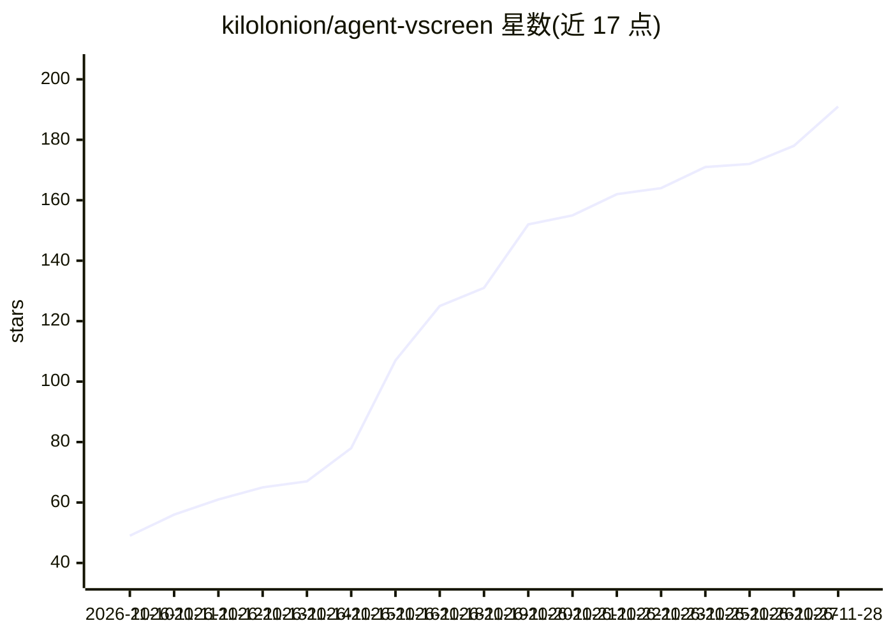

# kilolonion/agent-vscreen

⭐ 191 · Kotlin · MIT · 推送 2026-11-27 · [GitHub](https://github.com/kilolonion/agent-vscreen) · [官网](https://github.com/kilolonion/agent-vscreen/releases/latest) · 个人维护 · 中文 README

**安卓后台虚拟屏：让任何 AI agent 替你操作手机应用**

在安卓手机上开启一块不可见的虚拟副屏，AI agent 在副屏上打开和操作应用，用户主屏不受影响；浮窗实时显示 agent 动作，可随时接管或停止。通过 Shizuku（无需 root）或 root 获取权限，支持 Android 11+、arm64。接入方式三种：终端 agent 用 vscreen CLI、支持 MCP 的 agent 用 MCP、自写代码用 HTTP API。应用本身不调用任何 AI 模型，屏幕含义由 agent 侧模型判断。

## 筛选速览

| 维度 | 判定 | 备注 |
|---|---|---|
| AI 角色 | `ai-ecosystem` | LLM/agent 周边工具 |
| 许可风险 | `permissive` | MIT |
| 部署形态 | `None` |  |
| 模型依赖 | — | README 未给出锁定关系 |
| 硬件要求 | — | 无带数字的原话,不猜 |
| 安装摩擦 | `medium` | 含编译或系统依赖之一 |
| 成熟度 | — | 结构信号不足 |

## 能力要点

- 虚拟副屏上执行点击/滑动/输入/按键，每步校验失败即停并报告屏幕状态
- 无障碍树与端侧 OCR（PP-OCRv6、ML Kit）合并为带坐标的元素列表
- 三种接入方式：vscreen CLI、MCP、HTTP /v2 API，每个 agent 独立 token
- 支持用户接管、teach 教学录制、handoff 交接与条件触发的持续监视

## 适用场景

- 让手机/电脑/云端的 agent 代我操作手机应用而我继续用手机
- 定时签到或到点检查等周期性任务的自动化
- 长时间页面内容的翻页收集与信息提取
- 需要密码或人脸等步骤时交还给我手动完成

## 场景标签

`GUI 自动化` · 领域:效率与自动化

## 证据(README 行号)

> L9:  MCP
> L43: - **Hands the screen to the agent**: every reply carries the screen as it is now, the words on it, the tappable ele
> L115: - **MCP**: agents that speak MCP add the address and token (transport `httpStream`).

## 星数曲线

2026-11-10 49 → 2026-11-28 191（+142）

---
*卡片 v1 · prompt 1.4 · 生成 2026-11-27 · 置信度 high · 依据 README sha `819cd733822a` · [字段定义](../../DATASET.md)*
