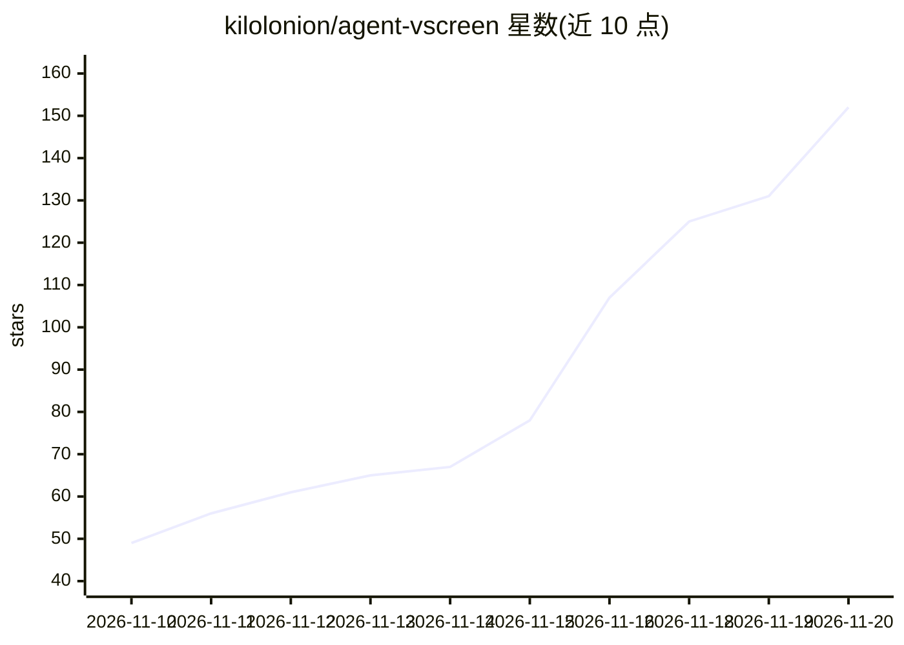

# kilolonion/agent-vscreen

⭐ 152 · Kotlin · MIT · 推送 2026-11-19 · [GitHub](https://github.com/kilolonion/agent-vscreen) · [官网](https://github.com/kilolonion/agent-vscreen/releases/latest) · 个人维护 · 中文 README

**给手机 AI agent 用的 Android 后台虚拟屏操作工具**

Android 应用，为手机上的 AI agent 提供一块不可见的虚拟显示屏：agent 通过 CLI（vscreen）、MCP 或 HTTP 驱动其他应用（启动、点击、滑动、输入、等待），每步返回屏幕、可见文本、可点元素与截图。内置离线 OCR（PaddleOCR/ML Kit）与时间感知、条件等待、步骤断言等脚手架；应用自身不调用任何模型，由调用方 agent 的模型决策。仅依赖 Shizuku 授权，无需 root，Android 11+（建议 14+）、arm64。支持悬浮窗监视与人工接管、按应用设置禁用/只读、多 agent 会话轮替，可经内置 Tailscale 跨设备连接。当前应用 UI 为中文。

## 筛选速览

| 维度 | 判定 | 备注 |
|---|---|---|
| AI 角色 | `ai-ecosystem` | LLM/agent 周边工具 |
| 许可风险 | `permissive` | MIT |
| 部署形态 | `None` |  |
| 模型依赖 | — | README 未给出锁定关系 |
| 硬件要求 | — | 无带数字的原话,不猜 |
| 安装摩擦 | `medium` | 含编译或系统依赖之一 |
| 成熟度 | — | 结构信号不足 |

## 能力要点

- CLI / MCP / HTTP 三种接入方式，适配任意手机 agent
- 内置离线 OCR（PaddleOCR、ML Kit），应用自身不调用 LLM
- 仅 Shizuku 授权，无需 root 与 adb
- 悬浮窗实时镜像，用户可随时接管或停止 AI

## 适用场景

- 让手机 agent 在后台操作应用，同时不占用用户自己的屏幕
- 为不同 Android agent 提供统一的屏幕操作与感知工具
- 通过 Tailscale 让桌面或云端 agent 远程控制手机后台屏

## 场景标签

`GUI 自动化` · 领域:效率与自动化

## 证据(README 行号)

> L17: Any agent on the phone can use it: agents with a terminal use the `vscreen` CLI, agents that speak MCP use MCP, and
> L36: - **Reports the screen back**: after each action it returns the current screen, visible text and tappable elements,
> L57: - **No model inside, no fight over privileges**: the phone side calls no model; the caller's model decides what the

## 星数曲线

2026-11-10 49 → 2026-11-20 152（+103）

---
*卡片 v1 · prompt 1.4 · 生成 2026-11-17 · 置信度 high · 依据 README sha `6a958ba7b18b` · [字段定义](../../DATASET.md)*
