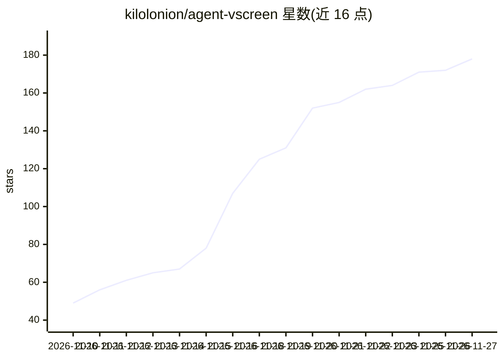

# kilolonion/agent-vscreen

⭐ 178 · Kotlin · MIT · 推送 2026-11-26 · [GitHub](https://github.com/kilolonion/agent-vscreen) · [官网](https://github.com/kilolonion/agent-vscreen/releases/latest) · 个人维护 · 中文 README

**安卓后台虚拟副屏，让任意 AI agent 操作手机应用**

在安卓手机上创建一块不可见的虚拟屏幕，AI agent 在副屏上打开并操作应用（点击、滑动、输入、等待），用户主屏不受影响，可通过悬浮窗查看、接管或停止。提供 CLI（vscreen）、MCP 与 HTTP 三种接入方式，通过 Shizuku 或 root 获取权限，无需 root 默认可用。应用本身不调用任何模型，由 agent 侧模型决定操作；支持 OCR 与无障碍树合并定位元素、定时与条件监听、步骤教学录制回放、多 agent 令牌隔离。需 Android 11+ 与 arm64。

## 筛选速览

| 维度 | 判定 | 备注 |
|---|---|---|
| AI 角色 | `ai-ecosystem` | LLM/agent 周边工具 |
| 许可风险 | `permissive` | MIT |
| 部署形态 | `None` |  |
| 模型依赖 | — | README 未给出锁定关系 |
| 硬件要求 | — | 无带数字的原话,不猜 |
| 安装摩擦 | `medium` | 含编译或系统依赖之一 |
| 成熟度 | — | 结构信号不足 |

## 能力要点

- 后台虚拟屏驱动应用：点击/滑动/输入/按键，每步校验失败即停并报告屏幕状态
- CLI / MCP / HTTP 三种接入方式，本地（127.0.0.1）与云端 agent 均可连接
- 无障碍树 + 端侧 OCR（PP-OCRv6、ML Kit）合并为带坐标的可点元素列表
- teach 教学录制、ask 让用户点选、handoff 与用户屏交接、条件监听通知

## 适用场景

- 让手机或云端的 agent 帮我在后台签到、填表、查资料，同时我继续用手机
- 给 agent 布置定时或条件触发的任务（如降价提醒、下载完成通知）
- 让 agent 翻页采集整页列表内容（订单、聊天记录、搜索结果）
- 把需要密码或人脸的步骤交还给我，其余交给 agent 完成

## 场景标签

`GUI 自动化` · 领域:效率与自动化

## 证据(README 行号)

> L11: **A background second screen on your Android phone, for any AI agent: on the phone, on a computer or in the cloud.*
> L43: - **Hands the screen to the agent**: every reply carries the screen as it is now, the words on it, the tappable ele
> L114: - **MCP**: agents that speak MCP add the address and token (transport `httpStream`).

## 星数曲线

2026-11-10 49 → 2026-11-27 178（+129）

---
*卡片 v1 · prompt 1.4 · 生成 2026-11-26 · 置信度 high · 依据 README sha `a91965b7d836` · [字段定义](../../DATASET.md)*
