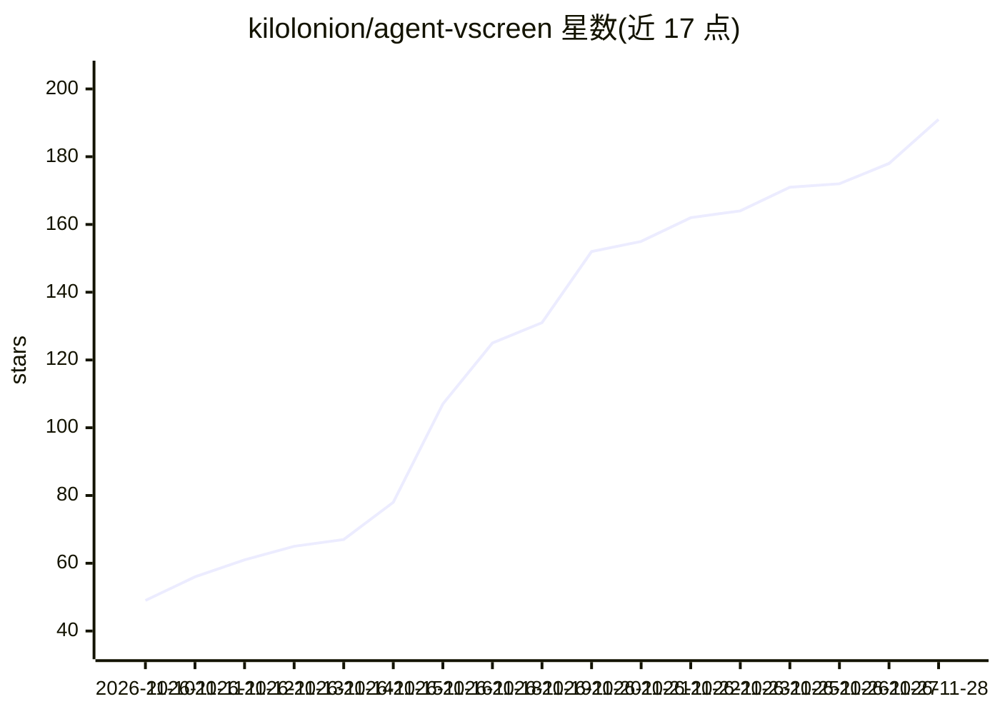

# kilolonion/agent-vscreen

⭐ 191 · Kotlin · MIT · 推送 2026-11-27 · [GitHub](https://github.com/kilolonion/agent-vscreen) · [官网](https://github.com/kilolonion/agent-vscreen/releases/latest) · 个人维护 · 中文 README

**安卓后台虚拟屏：让手机/电脑/云端的 AI agent 操作应用**

在 Android 手机上开启一个不可见的虚拟显示屏，供外部 AI agent 在其中打开并操作应用（点击、滑动、输入、按键），主屏幕使用不被占用；悬浮窗实时镜像画面并支持随时接管或停止。通过 vscreen CLI、MCP 或 HTTP 三种协议接入，权限来源为 Shizuku（或兼容 fork）或 Root；每个 agent 有独立 token 与权限表，支付等高风险操作需本机生物识别/PIN 确认。要求 Android 11+，手机上不运行任何 AI 模型。

## 筛选速览

| 维度 | 判定 | 备注 |
|---|---|---|
| AI 角色 | `ai-ecosystem` | LLM/agent 周边工具 |
| 许可风险 | `permissive` | MIT |
| 部署形态 | `None` |  |
| 模型依赖 | — | README 未给出锁定关系 |
| 硬件要求 | — | 无带数字的原话,不猜 |
| 安装摩擦 | `medium` | 含编译或系统依赖之一 |
| 成熟度 | — | 结构信号不足 |

## 能力要点

- 隔离虚拟屏上的后台应用操作，主屏使用不受影响
- CLI / MCP / HTTP 三种协议接入，模型无关
- 每 agent 独立 token 与 6 行权限表，高风险操作需生物识别/PIN 确认
- 端上 OCR（PP-OCRv6 / ML Kit）与时间线感知、人工接管机制

## 适用场景

- 让手机上的 agent 在后台屏开计时器、发消息等操作
- 电脑或云端的 agent 远程驱动手机应用完成自动化任务
- 后台任务运行时随时长按悬浮窗接管人工操作

## 场景标签

`GUI 自动化` · 领域:效率与自动化

## 证据(README 行号)

> L11: **A background second screen on your Android phone, for any AI agent: on the phone, on a computer or in the cloud.*
> L15: Agent-VScreen opens and drives other apps on an invisible virtual display so your main screen stays untouched. A sm
> L46: - **Any agent, any model**: no AI model runs on the phone; anything speaking CLI, MCP, or HTTP can connect.

## 星数曲线

2026-11-10 49 → 2026-11-28 191（+142）

---
*卡片 v1 · prompt 1.4 · 生成 2026-11-28 · 置信度 high · 依据 README sha `0b0ff8b31650` · [字段定义](../../DATASET.md)*
