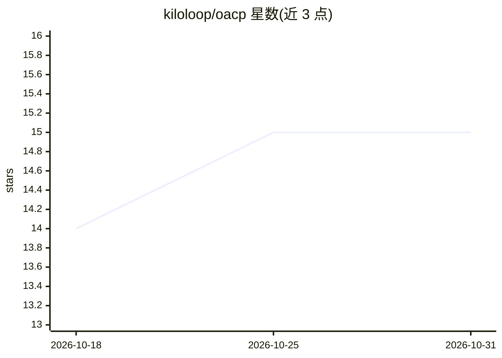

# kiloloop/oacp

⭐ 15 · Python · Apache-2.0 · 推送 2026-10-27 · [GitHub](https://github.com/kiloloop/oacp) · [官网](https://oacp.dev) · 个人维护

**基于文件的多 AI agent 协调协议与 CLI，无需服务器**

OACP 是一个用纯文件（YAML）实现的多 AI agent 协调协议与配套 CLI：agent 之间通过 inbox/outbox 收发类型化消息（任务派发、代码评审、交接），配合持久共享 memory、artifacts 与 checkpoints 目录。提供结构化评审循环（review_request→feedback→addressed→lgtm）与质量门禁、git 安全默认规则、本地密钥信任与人类审批记录。面向在本地机器/CI 上运行多个 agent 的开发者，运行时无关（Claude Code、Codex、Cursor 等），需 Python 3.9.2+ 与 Bash，经 uv/pipx 安装。

## 筛选速览

| 维度 | 判定 | 备注 |
|---|---|---|
| AI 角色 | `ai-ecosystem` | LLM/agent 周边工具 |
| 许可风险 | `permissive` | Apache-2.0 |
| 部署形态 | `library` | 以包/库形式分发 |
| 模型依赖 | — | README 未给出锁定关系 |
| 硬件要求 | — | 无带数字的原话,不猜 |
| 安装摩擦 | `low` | 无编译、无系统依赖或容器化 |
| 成熟度 | — | 结构信号不足 |

## 能力要点

- 纯文件 inbox/outbox 异步消息协议，无服务器、无守护进程
- 结构化评审循环与质量门禁（P0/P1 未决即不可合并）
- 跨运行时持久共享 memory 与 org-memory 层
- oacp trust 本地密钥与 oacp autonomy 人类审批/审计记录

## 适用场景

- 多个 AI agent 协作开发同一代码库时的任务派发与交接
- 为 agent 产出建立结构化代码评审与合并门禁
- 跨会话、跨机器保留项目决策与已知债务记录

## 场景标签

`多智能体` `代码审查` · 领域:Agent 开发

## 证据(README 行号)

> L11: A file-based protocol for multi-agent AI workflows. Two pillars — cross-agent communication and persistent shared m
> L78: - **Agent safety defaults** — baseline rules for git, credentials, and scope discipline
> L118: OACP solves this with a filesystem-based protocol that requires no server, no database, and no vendor lock-in. Age

## 星数曲线

2026-10-18 14 → 2026-10-31 15（+1）

---
*卡片 v1 · prompt 1.4 · 生成 2026-10-30 · 置信度 high · 依据 README sha `f19aefa62e62` · [字段定义](../../DATASET.md)*
