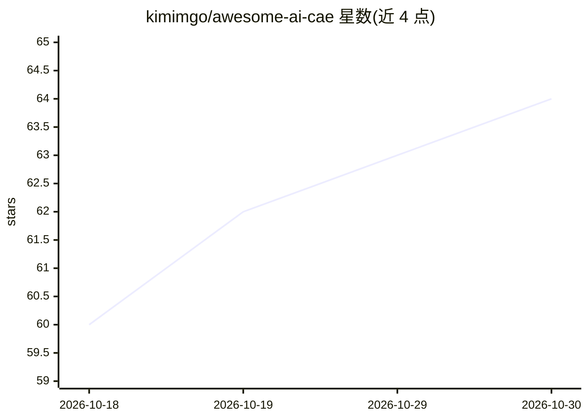

# kimimgo/awesome-ai-cae

⭐ 64 · Python · CC0-1.0 · 推送 2026-10-12 · [GitHub](https://github.com/kimimgo/awesome-ai-cae) · 个人维护 · 中文 README

**110+ 个 AI agent 可调用的 CAE 工具策展清单，按可调用性评分排名**

面向 agentic/LLM 驱动工程的开源 CAE 工具策展清单：收录 110+ 个 CFD、FEA、SPH、DEM、可视化等工具，仅收 headless 可驱动（MCP/Python/CLI）的工具。核心机制是 AI-Readiness Score（0-100），按 MCP、Python API、CLI、pip 可安装、维护状态等信号打分，由 readiness-score.py 每周自动重新生成，并提供 READINESS.md 表格与 machine-readable JSON/CSV。含 3 个 MCP server 条目、17 个核心求解器的人工编评、对 pip install+import 的冒烟验证。供为 agent 选型 CAE 工具的开发者使用。

## 筛选速览

| 维度 | 判定 | 备注 |
|---|---|---|
| AI 角色 | `ai-knowledge` | 知识聚合/清单类 |
| 许可风险 | `viral` | CC0-1.0 |
| 部署形态 | `library` | 以包/库形式分发 |
| 模型依赖 | — | README 未给出锁定关系 |
| 硬件要求 | — | 无带数字的原话,不猜 |
| 安装摩擦 | `medium` | 含编译或系统依赖之一 |
| 成熟度 | — | 结构信号不足 |

## 能力要点

- AI-Readiness Score 按 agent 可调用性（MCP/Python/CLI/pip/维护）排名，每周自动重新生成
- 收录 110+ 工具，含 3 个 MCP server（viznoir、paraview_mcp、openfoam-mcp-server）
- verify_install.py 做隔离 venv 的 pip install+import 冒烟验证，结果记录于 data/verified.json
- 提供 machine-readable 的 readiness.json 数据与多语言 README

## 适用场景

- 为 AI agent 挑选可直接通过 MCP/Python/CLI 调用的仿真工具
- 比较 CFD/FEA/SPH/DEM 求解器的可自动化程度
- 配置 MCP client（如 Claude Desktop、Cursor）接入 CAE 工具

## 场景标签

`精选清单` · 领域:学习与行业

## 证据(README 行号)

> L14: **Open-source simulation, CAD & meshing tools for agentic / LLM-driven engineering** — driveable headless via **MCP
> L51: > The headline metric: tools ranked by **agent-callability** — MCP, Python API, CLI, maintenance — not stars. Auto-

## 星数曲线

2026-10-18 60 → 2026-10-30 64（+4）

---
*卡片 v1 · prompt 1.4 · 生成 2026-10-24 · 置信度 mid · 依据 README sha `10e1027e500e` · [字段定义](../../DATASET.md)*
