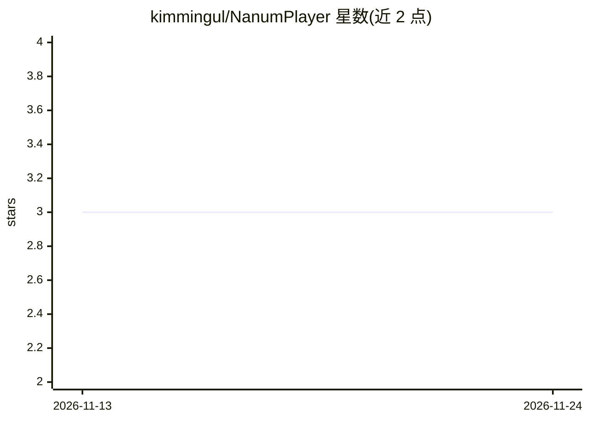

# kimmingul/NanumPlayer

⭐ — · [GitHub]() · 组织维护

**Windows 视频播放器：播放时实时生成离线 AI 字幕**

基于 mpv 的 Windows 视频播放器，支持本地文件、Blu-ray/DVD 光盘、YouTube 与网页视频。核心机制：whisper.cpp（CPU 或 NVIDIA GPU）做语音识别，翻译由用户自选的 Ollama 兼容服务器模型完成，字幕先于画面预生成并以字幕轨形式呈现；多条来源（AI/原始/文件/OCR）合并为一个带徽标的字幕列表。限制：翻译服务器与语音模型需单独安装，CUDA 识别需 CUDA 13 cuBLAS，解密组件不含在下载内。

## 筛选速览

| 维度 | 判定 | 备注 |
|---|---|---|
| AI 角色 | `ai-enhanced` | 去掉 AI 部分产品仍成立 |
| 许可风险 | `viral` | — |
| 部署形态 | `desktop` | 安装包/桌面程序 |
| 模型依赖 | local-ok | 支持本地模型 |
| 硬件要求 | — | 无带数字的原话,不猜 |
| 安装摩擦 | `medium` | 含编译或系统依赖之一 |
| 成熟度 | — | 结构信号不足 |

## 能力要点

- whisper.cpp 离线语音识别 + Ollama 翻译，实时生成字幕轨
- 33 种目标语言，含逐作品可编辑的术语表与翻译风格
- 无需播放即可批量生成源语言 SRT 及多语言翻译 SRT
- GPU 画质预设、RTX Video Super Resolution 与自定义 mpv shader

## 适用场景

- 看没有目标语言字幕的本地视频或光盘影片
- 给 YouTube 和网页视频实时加翻译字幕
- 离线批量生成 SRT 字幕文件
- 多音频语言影片从原始音轨生成第二字幕轨

## 场景标签

`语音识别` `图像视频处理` · 领域:感知与多模态

## 证据(README 行号)

> L5: NanumPlayer is a Windows video player built on mpv. It listens to the dialogue,
> L20: - **AI subtitles while you watch.** Speech recognition (whisper.cpp, on the CPU or on an NVIDIA GPU) feeds a transl
> L41:  with high-quality scaling, NVIDIA RTX Video Super Resolution and your own mpv shaders.

## 星数曲线

2026-11-13 3 → 2026-11-24 3（+0）

---
*卡片 v1 · prompt 1.4 · 生成 2026-11-21 · 置信度 high · 依据 README sha `d1ae546a02df` · [字段定义](../../DATASET.md)*
