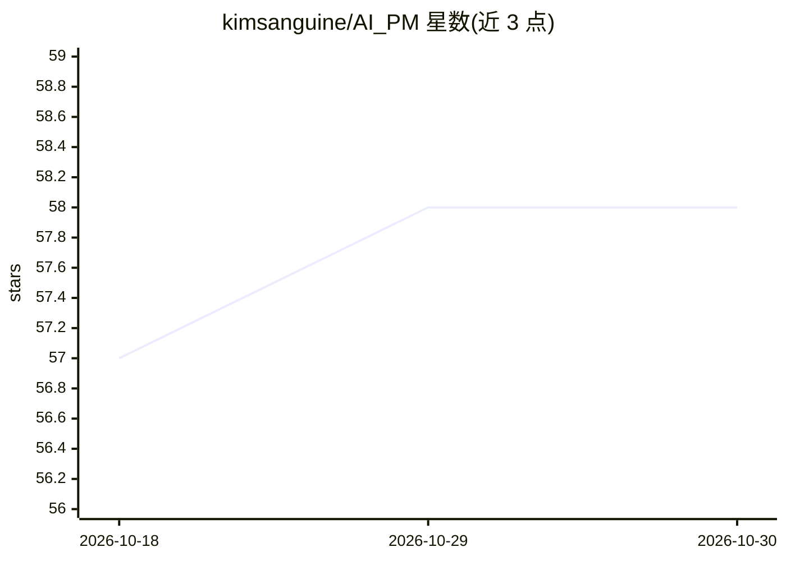

# kimsanguine/AI_PM

⭐ 58 · Python · NOASSERTION · 推送 2026-10-20 · [GitHub](https://github.com/kimsanguine/AI_PM) · 个人维护

**面向韩国语 PM 的 Claude Code 实战课程（8 部分 + 10 用例）**

以 claude-opus-4-8 为基准的韩语 PM 教学仓库：8 个部分覆盖 Claude Code 安装设置、上下文基础设施（CLAUDE.md/INDEX.md/Skills/Hooks）、Discovery→Definition→Delivery→Growth 全周期工作流、MCP 集成、自动化与 PM 职业策略，并附 10 个实战用例与按 Junior/Practitioner/Lead 分级的推荐学习路径。提供交互式课程（克隆仓库后在 Claude Code 中运行 /start）与插件安装两种使用方式。仓库为 CC BY-NC 4.0 许可，属于作者 AI Native 系列第三阶段，与 hplan 等姊妹仓库通过 opaque reference 协作但不合并数据。

## 筛选速览

| 维度 | 判定 | 备注 |
|---|---|---|
| AI 角色 | `ai-knowledge` | 知识聚合/清单类 |
| 许可风险 | `none` | NOASSERTION |
| 部署形态 | `None` |  |
| 模型依赖 | locked-api |  |
| 硬件要求 | — | 无带数字的原话,不猜 |
| 安装摩擦 | `low` | 无编译、无系统依赖或容器化 |
| 成熟度 | — | 结构信号不足 |

## 能力要点

- 8 部分课程 + 10 个实战用例，按 J/P/L 三级给出学习路径
- 教授 CLAUDE.md、INDEX.md、Skills、Hooks 四要素上下文基础设施
- 支持 Claude Code 插件市场两行命令安装
- 与 hplan/signal-to-growth 等姊妹仓库定义了职责边界与 opaque reference 传递方式

## 适用场景

- 作为 PM 按自身职级选择路径学习用 Claude Code 重构工作流
- 通过插件方式在 Claude Code 中直接使用本课程命令与技能
- 了解 PM 与姊妹工具（构建门禁、增长实验）之间的分工方式

## 场景标签

`教程课程` · 领域:学习与行业

## 证据(README 行号)

> L5: > 한국어 PM 을 위한 **Claude Code 실전 플레이북**. `claude-opus-4-8` 기준, 8파트 + 10 유즈케이스.
> L89: Claude Code(`claude-opus-4-8` 기준 CLI 에이전트)를 활용해 PM이 **Discovery → Definition → Delivery → Growth** 사이클 전반에서 일하는 방식을

## 星数曲线

2026-10-18 57 → 2026-10-30 58（+1）

---
*卡片 v1 · prompt 1.4 · 生成 2026-10-24 · 置信度 high · 依据 README sha `d5855dee99c5` · [字段定义](../../DATASET.md)*
