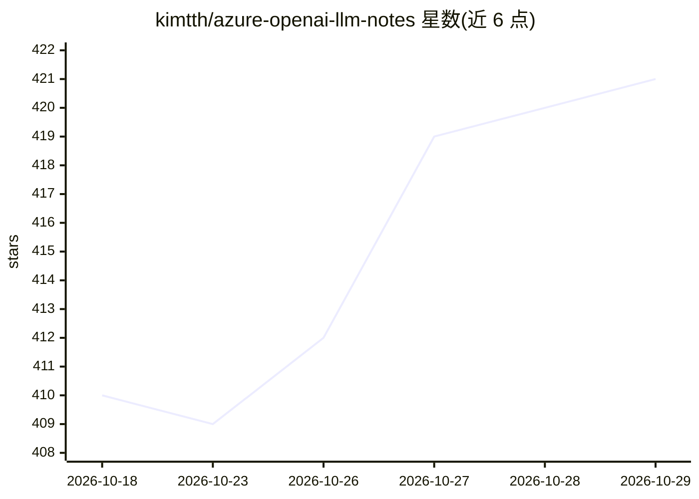

# kimtth/azure-openai-llm-notes

⭐ 421 · Python · 推送 2026-10-28 · [GitHub](https://github.com/kimtth/azure-openai-llm-notes) · [官网](https://github.com/kimtth/awesome-azure-openai-copilot) · 个人维护

**Azure OpenAI 与 LLM 应用资源的策展清单（月度更新）**

个人维护的 awesome 型资源目录，收录 Azure OpenAI、LLM 应用、RAG、Agent 框架与协议（A2A/MCP）、数据集与评测、最佳实践等分类条目。每条资源附简短摘要与日期标注，按时间组织；清单每月更新，更新前候选条目记录在 issue 中，归档或不活跃超 12 个月的应用移入 applications.old.md。提供按目标（如构建 RAG 应用、设计 Agent、运行本地模型）导航的阅读路径。无安装或运行形态，纯文档型仓库。

## 筛选速览

| 维度 | 判定 | 备注 |
|---|---|---|
| AI 角色 | `ai-knowledge` | 知识聚合/清单类 |
| 许可风险 | `none` | — |
| 部署形态 | `None` |  |
| 模型依赖 | — | README 未给出锁定关系 |
| 硬件要求 | — | 无带数字的原话,不猜 |
| 安装摩擦 | `low` | 无编译、无系统依赖或容器化 |
| 成熟度 | — | 结构信号不足 |

## 能力要点

- 按 Weights/Context/Agentic Engineering 三层组织的导航框架
- 条目附日期标注与简短摘要，月度更新机制
- 归档与不活跃超 12 个月的应用单独归档管理
- 提供 9 条按任务目标划分的入门路径

## 适用场景

- 查找 Azure OpenAI 与 Copilot 相关框架、工具和示例应用
- 按目标（建 RAG、设计 Agent、跑本地模型）找到起步资源
- 跟踪 LLM、Agent 与评测领域的论文和工具条目

## 场景标签

`精选清单` · 领域:学习与行业

## 证据(README 行号)

> L7: A comprehensive, curated collection of resources for Azure OpenAI, Large Language Models (LLMs), and their applicati
> L24: ## 1. App & Agent
> L87: ## 3. Research & Survey

## 星数曲线

2026-10-18 410 → 2026-10-29 421（+11）

---
*卡片 v1 · prompt 1.4 · 生成 2026-10-21 · 置信度 high · 依据 README sha `4e534049f422` · [字段定义](../../DATASET.md)*
