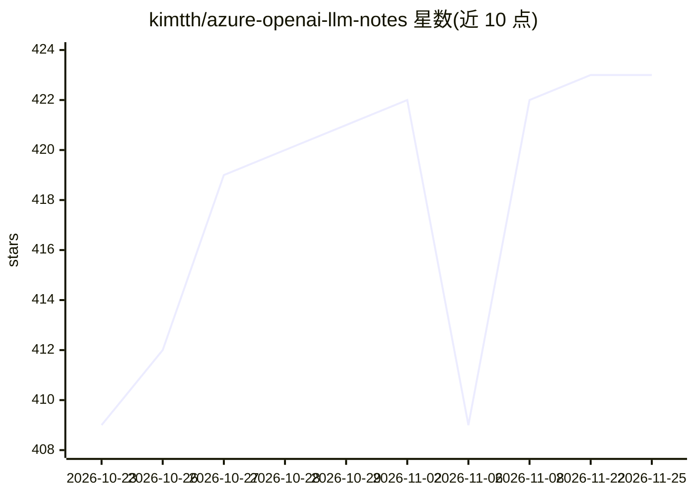

# kimtth/azure-openai-llm-notes

⭐ 423 · Python · 推送 2026-11-05 · [GitHub](https://github.com/kimtth/azure-openai-llm-notes) · 个人维护

**面向 Azure OpenAI 与 LLM 开发者的策展资源清单，每月更新**

按时间顺序组织的资源合集，覆盖 Azure OpenAI、Copilot、RAG、Agent 框架、模型训练、评测与安全等主题，每条资源附简短描述并标注日期；按权重、上下文、Agentic 工程三个时代分层导航，并提供按目标选择路径的起始指南。遵循官方 Awesome 规则进行 lint，仅收录 Azure 与 Microsoft 相关产品；归档或 12 个月以上无活动的应用移入 old.md 文件。

## 筛选速览

| 维度 | 判定 | 备注 |
|---|---|---|
| AI 角色 | `ai-knowledge` | 知识聚合/清单类 |
| 许可风险 | `none` | — |
| 部署形态 | `None` |  |
| 模型依赖 | locked-api |  |
| 硬件要求 | — | 无带数字的原话,不猜 |
| 安装摩擦 | `low` | 无编译、无系统依赖或容器化 |
| 成熟度 | — | 结构信号不足 |

## 能力要点

- 每月更新，候选条目通过 issue 追踪
- Propedia 风格三层导航（Weights/Context/Agentic Engineering）
- 按目标给出学习路径的 Start Here 指南
- 遵循官方 Awesome 规则 lint，含推荐/视频/论文等标记图例

## 适用场景

- 构建 RAG 应用时查找 Azure 相关工具与设计模式资料
- 设计 AI agent 时按路径浏览框架与最佳实践
- 了解 Azure OpenAI 与 Copilot 生态的资源分布

## 场景标签

`精选清单` · 领域:学习与行业

## 证据(README 行号)

> L7: A comprehensive, curated collection of resources for Azure OpenAI, Large Language Models (LLMs), and their applicati
> L9: 🔹Concise Summaries: Each resource is briefly described for quick understanding
> L11: 🔹Monthly Updates: The list is updated monthly; candidate entries before the update are tracked in the issue.

## 星数曲线

2026-10-23 409 → 2026-11-25 423（+14）

---
*卡片 v1 · prompt 1.4 · 生成 2026-11-25 · 置信度 high · 依据 README sha `a24dfdf0b0f2` · [字段定义](../../DATASET.md)*
