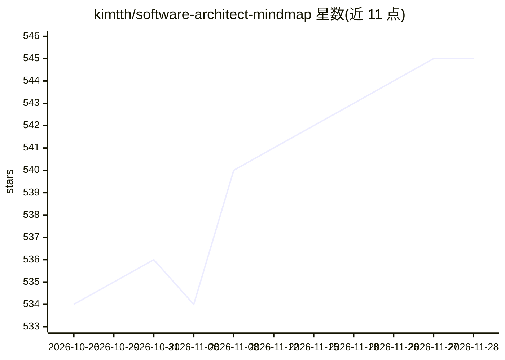

# kimtth/software-architect-mindmap

⭐ 545 · Python · MIT · 推送 2026-11-27 · [GitHub](https://github.com/kimtth/software-architect-mindmap) · 个人维护

**软件架构参考与学习资料策展清单**

最初为思维导图而建，现作为软件架构参考的聚合清单（curated list）运行。内容按系统设计、趋势报告、工程博客、云架构（AWS/Azure/GCP 对比与框架文档）、计算机科学课程、Transformer/LLM 基础、 diagram 工具与研究工具等章节组织，逐条链接外部资源；基于 Fresco Play 课程整理。不包含可运行代码或安装步骤，用途是查阅与学习导航。

## 筛选速览

| 维度 | 判定 | 备注 |
|---|---|---|
| AI 角色 | `ai-knowledge` | 知识聚合/清单类 |
| 许可风险 | `permissive` | MIT |
| 部署形态 | `None` |  |
| 模型依赖 | — | README 未给出锁定关系 |
| 硬件要求 | — | 无带数字的原话,不猜 |
| 安装摩擦 | `medium` | 含编译或系统依赖之一 |
| 成熟度 | `idea` | |

## 能力要点

- 软件架构与系统设计参考链接的分类聚合
- 覆盖 AWS/Azure/GCP 云架构对比资料与框架文档
- 含 Transformer/LLM 基础与 RAG/AI Agent 指南等 AI 相关参考章节
- 附图示工具、研究工具与工程实践清单

## 适用场景

- 系统学习软件架构与系统设计时查找参考资料
- 准备系统设计面试时按主题导航资料
- 了解云架构最佳实践与行业趋势报告来源

## 场景标签

`精选清单` `教程课程` · 领域:学习与行业

## 证据(README 行号)

> L3: - This repository was initially created for the mind map; currently, it is used as a curated collection of software 
> L10: ## Software Architecture Reference

## 星数曲线

2026-10-26 534 → 2026-11-28 545（+11）

---
*卡片 v1 · prompt 1.4 · 生成 2026-11-28 · 置信度 high · 依据 README sha `d70524cf01a4` · [字段定义](../../DATASET.md)*
