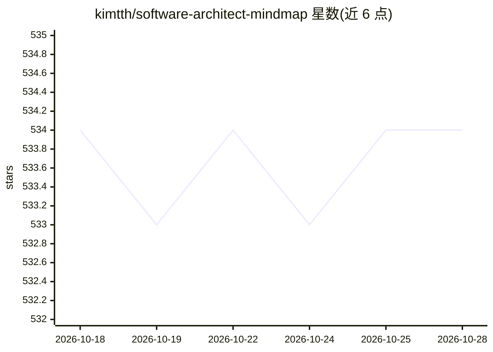

# kimtth/software-architect-mindmap

⭐ 535 · Python · MIT · 推送 2026-10-26 · [GitHub](https://github.com/kimtth/software-architect-mindmap) · 个人维护

**软件架构与工程术语概念的策展参考清单**

由个人维护的软件架构参考清单，最初为思维导图（基于 TCS 内部学习平台 Fresco Play 课程），现为策展链接集合。内容覆盖系统设计参考、行业趋势报告、Mini-books、云架构（AWS/Azure/GCP 对照）、CS 课程与微软 Beginner 系列、工程博客、Transformer/LLM 基础、算法可视化与研究工具、最佳实践与书籍等分类。面向开发者与架构学习者，纯 Markdown 文档仓库，无可安装代码，仅作阅读参考，更新包含 2025-2026 年条目。

## 筛选速览

| 维度 | 判定 | 备注 |
|---|---|---|
| AI 角色 | `ai-knowledge` | 知识聚合/清单类 |
| 许可风险 | `permissive` | MIT |
| 部署形态 | `None` |  |
| 模型依赖 | — | README 未给出锁定关系 |
| 硬件要求 | — | 无带数字的原话,不猜 |
| 安装摩擦 | `medium` | 含编译或系统依赖之一 |
| 成熟度 | — | 结构信号不足 |

## 能力要点

- 覆盖系统设计、云架构、趋势报告、课程等十余个分类的策展链接
- 包含 AWS/Azure/GCP 三云服务对照与架构框架条目
- 收录 Transformer/LLM 基础与 AI 学习门户条目
- 提供算法可视化、研究工具、制图工具等工具类条目

## 适用场景

- 系统设计面试备考时查找学习资源
- 做云架构选型时查阅三云服务对照与设计模式
- 了解软件行业趋势报告与工程博客
- 学习 LLM/Transformer 基础时定位入门材料

## 场景标签

`精选清单` · 领域:学习与行业

## 证据(README 行号)

> L3: - This repository was initially created for the mind map; currently, it is used as a curated collection of software 
> L12: - System Design 101: 🗺️ByteByteGo. System design basics explained with diagrams

## 星数曲线

2026-10-18 534 → 2026-10-28 534（+0）

---
*卡片 v1 · prompt 1.4 · 生成 2026-10-21 · 置信度 high · 依据 README sha `17a122528d10` · [字段定义](../../DATASET.md)*
