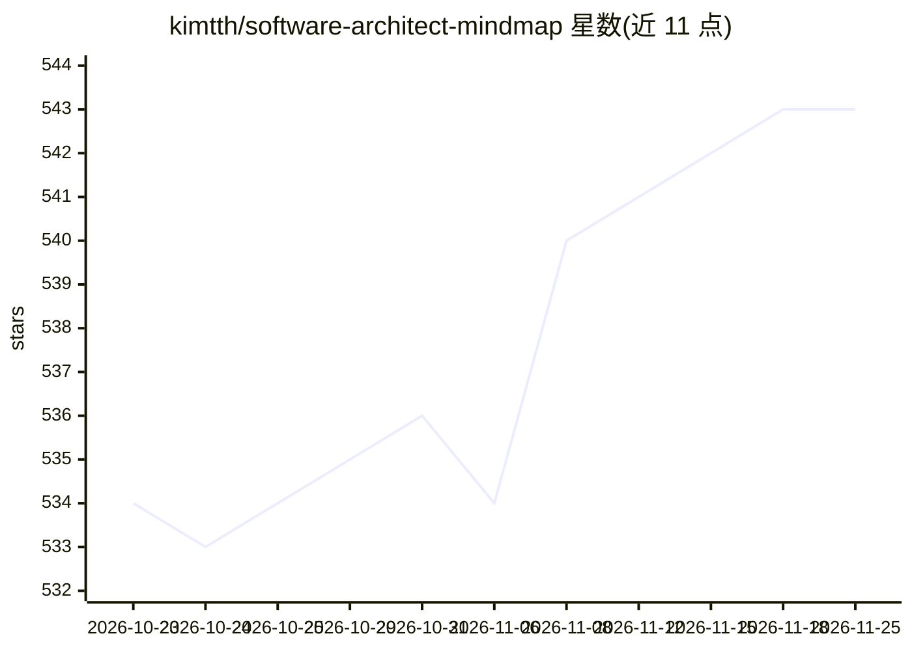

# kimtth/software-architect-mindmap

⭐ 543 · Python · MIT · 推送 2026-11-20 · [GitHub](https://github.com/kimtth/software-architect-mindmap) · 个人维护

**软件开发者的软件架构参考资料合集**

最初为思维导图创建，现作为软件架构参考文献的精选集合：涵盖系统设计、架构模式、云架构（AWS/Azure/GCP 对照）、工程博客、Transformer 与 LLM 基础、算法可视化、图表工具、研究工具与 CS 教程等主题的链接汇编，基于 Tata Consultancy Services 的 Fresco Play 课程整理。README 为纯链接列表，无安装与运行说明。

## 筛选速览

| 维度 | 判定 | 备注 |
|---|---|---|
| AI 角色 | `ai-knowledge` | 知识聚合/清单类 |
| 许可风险 | `permissive` | MIT |
| 部署形态 | `None` |  |
| 模型依赖 | — | README 未给出锁定关系 |
| 硬件要求 | — | 无带数字的原话,不猜 |
| 安装摩擦 | `medium` | 含编译或系统依赖之一 |
| 成熟度 | — | 结构信号不足 |

## 能力要点

- 按云架构、LLM 基础、设计模式等主题组织的链接清单
- 收录趋势报告（InfoQ/Gartner/Thoughtworks/DORA）与工程博客列表
- 含微软 Beginner 系列教程与 Transformer 可视化学习资源

## 适用场景

- 准备系统设计面试时查找学习资料
- 学习云架构模式与 Azure/AWS/GCP 服务对照
- 查找 Transformer、RAG、AI Agent 等主题的入门指南

## 场景标签

`精选清单` · 领域:学习与行业

## 证据(README 行号)

> L3: - This repository was initially created for the mind map; currently, it is used as a curated collection of software 
> L10: ## Software Architecture Reference

## 星数曲线

2026-10-23 534 → 2026-11-25 543（+9）

---
*卡片 v1 · prompt 1.4 · 生成 2026-11-25 · 置信度 high · 依据 README sha `c4ff036076fc` · [字段定义](../../DATASET.md)*
