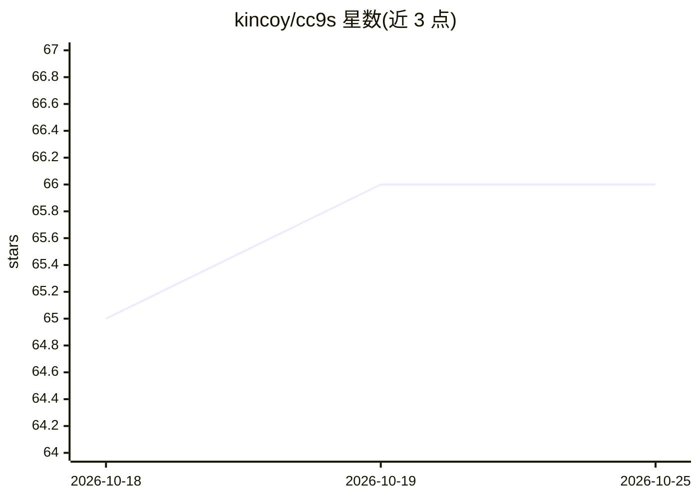

# kincoy/cc9s

⭐ 66 · Go · MIT · 推送 2026-04-27 · [GitHub](https://github.com/kincoy/cc9s) · 个人维护 · 中文 README

**管理 Claude Code 会话的 k9s 风格终端 TUI/CLI**

用 Go 编写的全屏终端 UI，用于浏览、搜索、检查和批量清理 Claude Code 会话：读取 ~/.claude/projects/ 下的 JSONL 文件，按 Projects → Sessions 两级导航展示，支持会话恢复、实时搜索、删除确认，并可查看项目/用户/插件三种作用域下的 skills、commands 与 agents 资源及 Ready/Invalid 状态。另附只读 CLI（status/sessions cleanup 等），支持 --json 结构化输出供脚本与 AI agent 使用。cleanup 按对话深度、工具使用、token 投入等维度给会话打分分组。需 Go 1.25+ 编译或 Homebrew 安装，macOS/Linux 运行，不修改会话数据。

## 筛选速览

| 维度 | 判定 | 备注 |
|---|---|---|
| AI 角色 | `ai-ecosystem` | LLM/agent 周边工具 |
| 许可风险 | `permissive` | MIT |
| 部署形态 | `library` | 以包/库形式分发 |
| 模型依赖 | — | README 未给出锁定关系 |
| 硬件要求 | — | 无带数字的原话,不猜 |
| 安装摩擦 | `low` | 无编译、无系统依赖或容器化 |
| 成熟度 | — | 结构信号不足 |

## 能力要点

- 两级导航的键盘驱动 TUI：会话浏览/搜索/恢复/批量删除
- 浏览项目、用户、插件作用域的 skills/commands/agents 及状态
- 只读 CLI 与 --json 结构化输出，供脚本和 AI agent 调用
- cleanup 按对话深度/工具使用/token 投入评分并分组给出清理建议

## 适用场景

- 多项目积累大量 Claude Code 会话后快速查找与清理
- 在终端里查看会话统计、对话日志与工具调用记录
- 脚本或 AI agent 通过 JSON 输出获取 Claude Code 环境快照

## 场景标签

 · 领域:开发者工具/AI 编码辅助

## 证据(README 行号)

> L13: Claude Code stores session data as JSONL files under `~/.claude/`. When you accumulate hundreds of sessions across 
> L247: cc9s reads JSONL files from `~/.claude/projects/`, then discovers available resource pages from project `.claude/s
> L41: - **CLI mode** — Read-only command suite for shell scripts and automation (`cc9s status`, `cc9s projects list`, `cc

## 星数曲线

2026-10-18 65 → 2026-10-25 66（+1）

---
*卡片 v1 · prompt 1.4 · 生成 2026-10-24 · 置信度 high · 依据 README sha `574e775c1ad7` · [字段定义](../../DATASET.md)*
