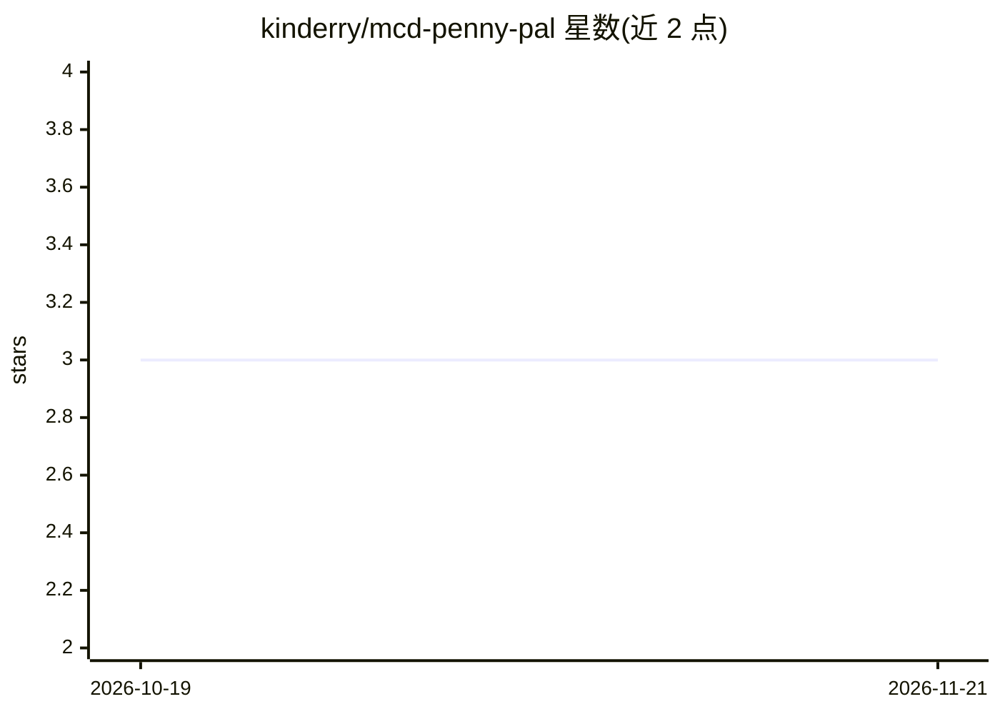

# kinderry/mcd-penny-pal

⭐ 3 · Python · MIT · 推送 2026-10-16 · [GitHub](https://github.com/kinderry/mcd-penny-pal) · 个人维护 · 中文 README

**基于麦当劳官方 MCP 的个人优惠券省钱提醒工具**

调用麦当劳中国官方 MCP（mcp.mcd.cn）只读接口的工具：合并四路券池、用 calculate-price 真实计价得出每张券的实际省钱额、做临期提醒并生成可分享的战报卡片；另含下单与消费记录能力。仅用 Python 3.11+ 标准库实现，无第三方依赖，离线演示模式读取脱敏的真实接口返回，无需 Token 与账号；接真实账号需配置环境变量，也可作为 WorkBuddy 自定义连接器接入。参赛作品，非麦当劳官方产品。

## 筛选速览

| 维度 | 判定 | 备注 |
|---|---|---|
| AI 角色 | `ai-ecosystem` | LLM/agent 周边工具 |
| 许可风险 | `permissive` | MIT |
| 部署形态 | `None` |  |
| 模型依赖 | — | README 未给出锁定关系 |
| 硬件要求 | — | 无带数字的原话,不猜 |
| 安装摩擦 | `low` | 无编译、无系统依赖或容器化 |
| 成熟度 | — | 结构信号不足 |

## 能力要点

- 四路券池合并与按「券名+到期时刻」去重
- 通过官方计价接口计算真实省钱额而非券面价
- 零 Token 离线演示模式，仅依赖 Python 3.11+ 标准库
- 1080×1440 可分享战报卡片生成

## 适用场景

- 提醒临期麦当劳优惠券避免过期浪费
- 比较各券真实省钱额决定怎么点最省
- 生成省钱战报卡片发社交平台

## 场景标签

`工作流自动化` · 领域:效率与自动化

## 证据(README 行号)

> L10: 基于麦当劳中国官方 MCP（`mcp.mcd.cn`）· 只调只读接口算钱 · 零 Token 就能跑通全链路
> L167: 也可以作为 WorkBuddy 自定义连接器接入，配置样例见 `mcp-config.example.json`，

## 星数曲线

2026-10-19 3 → 2026-11-21 3（+0）

---
*卡片 v1 · prompt 1.4 · 生成 2026-11-21 · 置信度 mid · 依据 README sha `a43b015e1b44` · [字段定义](../../DATASET.md)*
