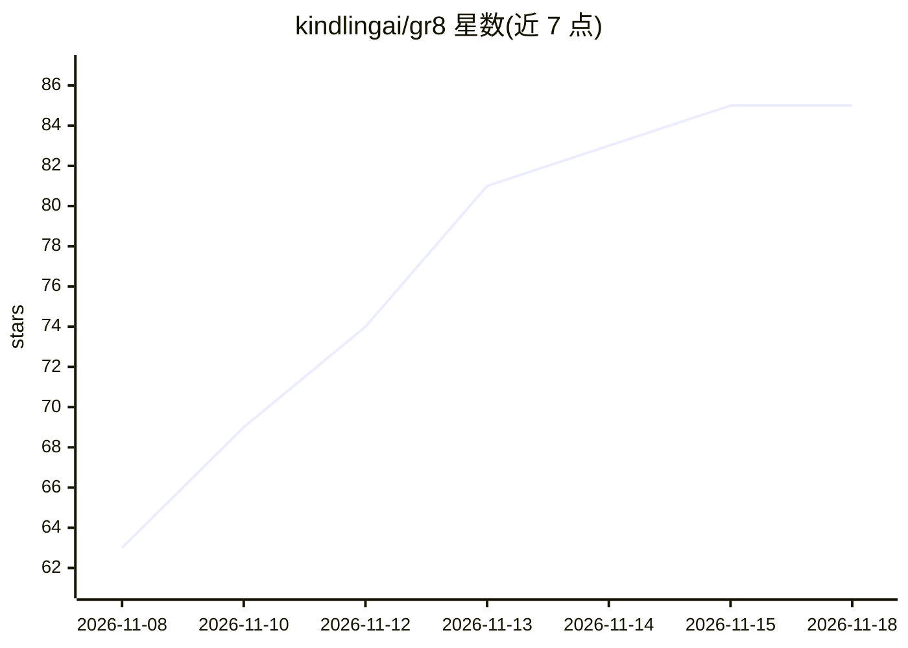

# kindlingai/gr8

⭐ 85 · Cuda · MIT · 推送 2026-11-17 · [GitHub](https://github.com/kindlingai/gr8) · 组织维护

**面向 DGX Spark 的 CUDA 推理引擎，服务 GLM/DeepSeek 模型**

gr8 是从零用 CUDA 编写的 LLM 推理引擎，在 1-6 台 DGX Spark (GB10) 上运行 GLM-5.3、GLM-5.3-Flash 与 DeepSeek-V4.1-Flash，通过首机的 OpenAI 兼容 HTTP API（端口 8100）提供服务；serve 时不使用 vLLM、PyTorch 或 NCCL。支持张量并行、INT4/F P8 KV 缓存格式、前缀复用、SSD/RDMA 远程 KV、图像输入，配套 Kindling dash 监控页与逐模型 recipe 镜像。当前为 Beta 版，硬件事定性要求高（如 DeepSeek-V4.1-Flash 每机约 510 GB 权重）。

## 筛选速览

| 维度 | 判定 | 备注 |
|---|---|---|
| AI 角色 | `ai-ecosystem` | LLM/agent 周边工具 |
| 许可风险 | `permissive` | MIT |
| 部署形态 | `self-host` | docker 或自建部署 |
| 模型依赖 | — | README 未给出锁定关系 |
| 硬件要求 | — | 无带数字的原话,不猜 |
| 安装摩擦 | `low` | 无编译、无系统依赖或容器化 |
| 成熟度 | `idea` | |

## 能力要点

- 从零 CUDA 实现，serve 时不依赖 vLLM/PyTorch/NCCL
- 1-6 台 GB10 张量并行服务三种模型，OpenAI 兼容 API
- 前缀复用与 SSD/RDMA 远程 KV 分层存储
- 统一 Docker 镜像覆盖全部 TP 宽度与三种模型

## 适用场景

- 在 DGX Spark 集群上自建 GLM/DeepSeek 推理服务
- 长上下文多并发聊天服务（最高 1M token 上下文配置）
- 通过 OpenAI 兼容 API 接入自有客户端与工具链

## 场景标签

`推理引擎` · 领域:训练与推理

## 证据(README 行号)

> L9: gr8 serves GLM-5.3, GLM-5.3-Flash and DeepSeek-V4.1-Flash on one to six DGX Spark (GB10) boxes (the count depends on
> L10: the model, see below), with an OpenAI-compatible API on the first box. gr8 is written from scratch in CUDA and uses

## 星数曲线

2026-11-08 63 → 2026-11-18 85（+22）

---
*卡片 v1 · prompt 1.4 · 生成 2026-11-18 · 置信度 high · 依据 README sha `a8befd5e989e` · [字段定义](../../DATASET.md)*
