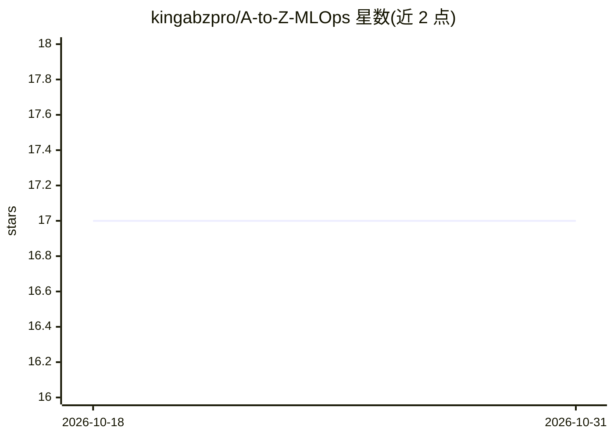

# kingabzpro/A-to-Z-MLOps

⭐ 17 · Jupyter Notebook · MIT · 推送 2026-10-13 · [GitHub](https://github.com/kingabzpro/A-to-Z-MLOps) · 个人维护

**新闻分类端到端 MLOps 管道：训练、部署、监控一体化**

端到端机器学习流水线项目：接入新闻数据、训练分类模型，并通过 FastAPI REST API 提供预测服务。使用 Prefect 编排数据处理、训练与部署流程；MLflow 做实验跟踪与模型版本晋升（champion 别名由晋升门控移动）；Prometheus/Grafana/Alertmanager 提供指标与告警；Docker Compose 用于本地运行，Kubernetes 用于生产部署；含 Locust 负载测试与单元/集成测试。给学习或搭建生产级 MLOps 流水线的开发者使用。

## 筛选速览

| 维度 | 判定 | 备注 |
|---|---|---|
| AI 角色 | `ai-ecosystem` | LLM/agent 周边工具 |
| 许可风险 | `permissive` | MIT |
| 部署形态 | `self-host` | docker 或自建部署 |
| 模型依赖 | — | README 未给出锁定关系 |
| 硬件要求 | — | 无带数字的原话,不猜 |
| 安装摩擦 | `low` | 无编译、无系统依赖或容器化 |
| 成熟度 | — | 结构信号不足 |

## 能力要点

- Prefect 编排数据→训练→部署的自动化流水线
- FastAPI 提供批量预测、鉴权、限流与缓存
- MLflow champion 别名模型晋升门控机制
- Prometheus/Grafana/Alertmanager 全链路可观测性

## 适用场景

- 搭建带监控与编排的文本分类生产流水线
- 学习 MLOps 全流程实践（CI/CD、可观测性、模型晋升）
- 以 docker-compose 一键起本地完整服务栈做实验

## 场景标签

`MLOps` · 领域:训练与推理

## 证据(README 行号)

> L3: Production-ready MLOps pipeline for classifying news articles. Built with FastAPI, Docker, Kubernetes, and modern ob
> L7: An end-to-end machine learning pipeline that ingests news data, trains classification models, and serves predictions
> L13: - **🔄 Automated Pipeline** - Data processing, model training, and deployment orchestrated with Prefect

## 星数曲线

2026-10-18 17 → 2026-10-31 17（+0）

---
*卡片 v1 · prompt 1.4 · 生成 2026-10-29 · 置信度 high · 依据 README sha `e42362cfb0d8` · [字段定义](../../DATASET.md)*
