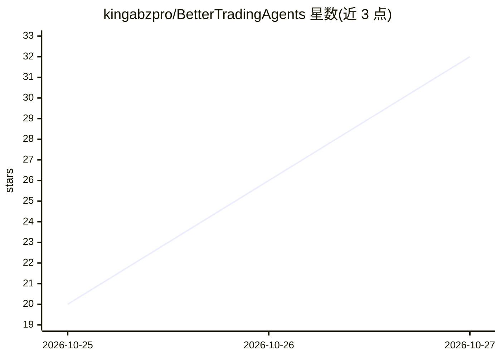

# kingabzpro/BetterTradingAgents

⭐ 32 · Python · MIT · 推送 2026-10-26 · [GitHub](https://github.com/kingabzpro/BetterTradingAgents) · [官网](https://github.com/kingabzpro/BetterTradingAgents/wiki) · 个人维护

**多智能体股票研究模拟交易平台：生成风险控制的买卖建议**

基于 CrewAI 的多智能体股票研究与纸面交易应用：6 个分析师并行研究（市场状态、技术面、基本面、新闻、情绪、预测），经多空辩论与中立裁判，输出带仓位规模的 BUY/HOLD/SELL 决策及完整推理链，事后按 SPY 基准评分。仅支持 Alpaca 纸面交易，无实盘路径；兼容任意 OpenAI 类端点（含本地 Ollama/vLLM），无 LLM key 时以 mock 模式运行。由 FastAPI 提供 Web 界面与 REST API，含走步回测、自动驾驶定时会话与 SQLite 历史记录。

## 筛选速览

| 维度 | 判定 | 备注 |
|---|---|---|
| AI 角色 | `ai-native` | 本体是模型或模型工具 |
| 许可风险 | `permissive` | MIT |
| 部署形态 | `None` |  |
| 模型依赖 | local-ok | 支持本地模型 |
| 硬件要求 | — | 无带数字的原话,不猜 |
| 安装摩擦 | `low` | 无编译、无系统依赖或容器化 |
| 成熟度 | — | 结构信号不足 |

## 能力要点

- 6 分析师并行 + 多空辩论 + 中立裁判 + 风险门控决策
- 任意 OpenAI 兼容端点（OpenAI/DeepSeek/OpenRouter/vLLM/Ollama），按角色配模型并自动回退
- 走步回测按成本后 alpha 对 SPY 评分
- 无 LLM key 时 mock 模式在真实行情数据上运行

## 适用场景

- 我想让多智能体研究股票并给出带推理链的买卖建议
- 在 Alpaca 纸面账户上模拟交易并跟踪相对 SPY 的表现
- 回放历史日期，评估策略在不同深度档位的成本后表现

## 场景标签

`多智能体` `金融量化` · 领域:Agent 开发

## 证据(README 行号)

> L3: **Real-time, multi-agent AI stock research and paper trading, powered by CrewAI.**
> L13: Six analysts research each ticker in parallel (market regime, technicals, fundamentals,
> L16: reasoning trail. Every call is later graded against what the market actually did.

## 星数曲线

2026-10-25 20 → 2026-10-27 32（+12）

---
*卡片 v1 · prompt 1.4 · 生成 2026-10-26 · 置信度 high · 依据 README sha `a35806970f39` · [字段定义](../../DATASET.md)*
