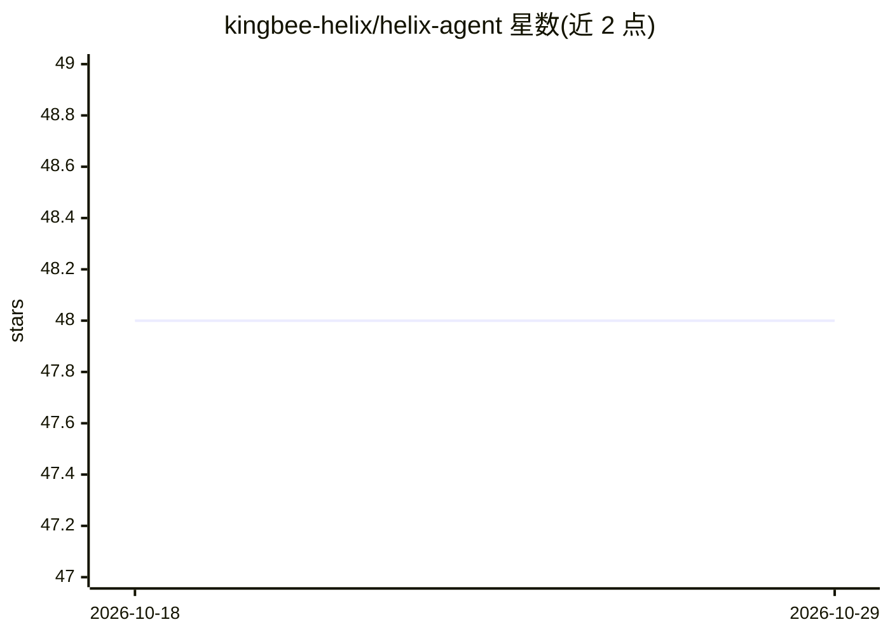

# kingbee-helix/helix-agent

⭐ 48 · Python · MIT · 推送 2026-09-05 · [GitHub](https://github.com/kingbee-helix/helix-agent) · 个人维护

**基于 Claude Code 的个人常驻 AI 代理，接入 Discord/Telegram/Web**

Helix 是 Claude Code CLI 的前端封装：AI 调用经 Claude Code 路由，使用用户已有的 Claude Pro/Max 订阅，无需 API key。为代理提供持久身份（AGENTS.md/SOUL.md 等工作区文件）、长期记忆、自定义斜杠命令、技能工厂、cron 定时任务，并通过 Discord、Telegram 或本地 Web 管理界面实现常驻访问。采用 --resume 会话续传机制降低 token 消耗；secrets 用 Fernet 加密、密钥绑定本机。限个人本地使用，要求 Python 3.10+ 与 Claude Code CLI，主要平台为 Linux。

## 筛选速览

| 维度 | 判定 | 备注 |
|---|---|---|
| AI 角色 | `ai-native` | 本体是模型或模型工具 |
| 许可风险 | `permissive` | MIT |
| 部署形态 | `library` | 以包/库形式分发 |
| 模型依赖 | locked-api |  |
| 硬件要求 | — | 无带数字的原话,不猜 |
| 安装摩擦 | `low` | 无编译、无系统依赖或容器化 |
| 成熟度 | — | 结构信号不足 |

## 能力要点

- 通过 Claude Code CLI 路由所有 AI 调用，复用订阅无需 API key
- 持久身份与记忆系统（SOUL.md/MEMORY.md/每日日志，代理可自行编辑）
- Discord/Telegram/Web UI 多渠道常驻接入，含用户白名单与速率限制
- --resume 会话续传与 /compact 压缩，支持跨模型切换

## 适用场景

- 在手机消息应用里随时与我常驻的 Claude 代理对话
- 让代理按 cron 计划执行定时任务与心跳检查
- 为代理配置个性、记忆和自定义命令，长期陪伴使用

## 场景标签

`AI 助手` `编码 Agent` · 领域:编码与开发

## 证据(README 行号)

> L3: A personal AI agent harness powered by Claude Code. Give your AI assistant a name, a personality, persistent memory,
> L5: Helix acts as a frontend for Claude Code — all AI calls route through Claude's CLI using your existing subscription.
> L90: Helix wraps Claude Code's CLI (`claude -p`). When you send a message:

## 星数曲线

2026-10-18 48 → 2026-10-29 48（+0）

---
*卡片 v1 · prompt 1.4 · 生成 2026-10-25 · 置信度 mid · 依据 README sha `1651f7e71077` · [字段定义](../../DATASET.md)*
