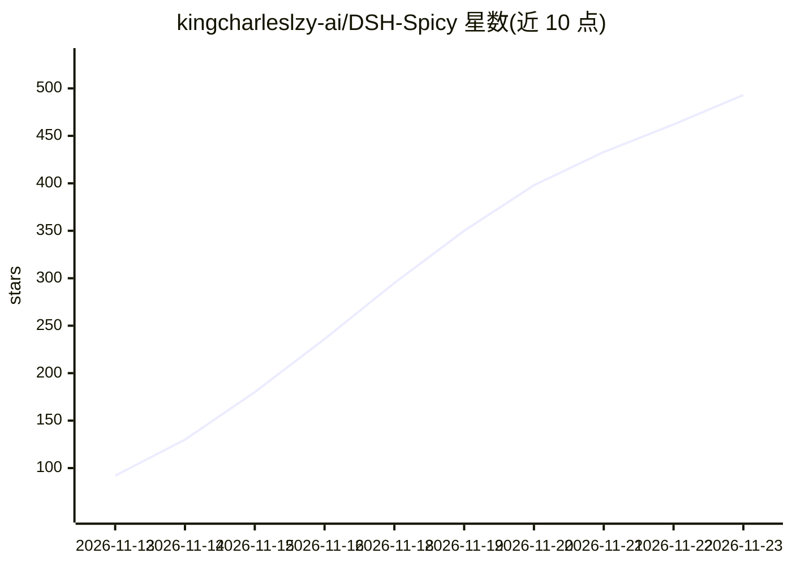

# kingcharleslzy-ai/DSH-Spicy

⭐ 493 · TypeScript · Apache-2.0 · 推送 2026-11-13 · [GitHub](https://github.com/kingcharleslzy-ai/DSH-Spicy) · [官网](https://kingcharleslzy-ai.github.io/DSH-Spicy/) · 个人维护 · 中文 README

**DSH 平台的 NSFW 图像/视频创作插件，用自托管模型生成成人内容**

面向 DeepSeek Harness（DSH）的插件，安装包名 dsh-qwen-studio。在对话 Agent 中调用自托管模型完成 NSFW 成人向创作：用 Qwen 图像模型生成定妆照、参考图编辑、LoRA/ControlNet/蒙版局部重绘，再用 MiniMax H3 生成单镜有声 MP4，并由 Agent 按角色卡与分镜推进多镜头短片、配音旁白与剪辑导出。支持 Apple Silicon 本机、本机或远程 NVIDIA GPU 等多种部署位置。权重约 57 GB 与算力由安装者自行管理。安装通过 DSH 插件市场索引或 Release TGZ，附 SHA256 校验。

## 筛选速览

| 维度 | 判定 | 备注 |
|---|---|---|
| AI 角色 | `ai-ecosystem` | LLM/agent 周边工具 |
| 许可风险 | `permissive` | Apache-2.0 |
| 部署形态 | `None` |  |
| 模型依赖 | — | README 未给出锁定关系 |
| 硬件要求 | — | 无带数字的原话,不猜 |
| 安装摩擦 | `medium` | 含编译或系统依赖之一 |
| 成熟度 | — | 结构信号不足 |

## 能力要点

- 对话 Agent 驱动的图像生成、参考编辑、蒙版重绘与批量任务
- MiniMax H3 单镜有声视频（1–15 秒，480p/768p，Turbo/质量档）
- 多镜头长片流程：角色卡、分镜、逐镜重做、旁白与剪辑导出
- 支持 Apple Silicon（MFLUX）与 NVIDIA（ComfyUI、远程 SSH）多种后端

## 适用场景

- 在本地或自有 GPU 上生成成人向图像与写真，不依赖第三方托管
- 从单张定妆照出发制作单镜有声视频
- 用 Agent 维持角色一致性，制作多镜头短片并剪辑成片

## 场景标签

`图像生成` `视频生成` · 领域:内容生成

## 证据(README 行号)

> L17: 在 DeepSeek Harness 中制作 **NSFW 成人向图像、有声视频和多镜头短片**。从成年虚构角色的一张定妆照开始，用 Qwen Image 2.1 调整造型、光线和构图，再交给 MiniMax H3 拍成有声镜头。
> L33: DSH **0.2.2-rc.1 或更新版本**。在「插件 → 发现 → 索引源」添加 本项目市场索引，选择 **DSH-Spicy**（安装包 `dsh-qwen-studio`）。也可以从 Release 下载 预编译 TGZ
> L64: 插件随包提供工作流、桥接和技能。权重、算力、连接和作品由安装者自行管理。可以只配置要用的功能。

## 星数曲线

2026-11-13 92 → 2026-11-23 493（+401）

---
*卡片 v1 · prompt 1.4 · 生成 2026-11-17 · 置信度 high · 依据 README sha `5c1282f13bd0` · [字段定义](../../DATASET.md)*
