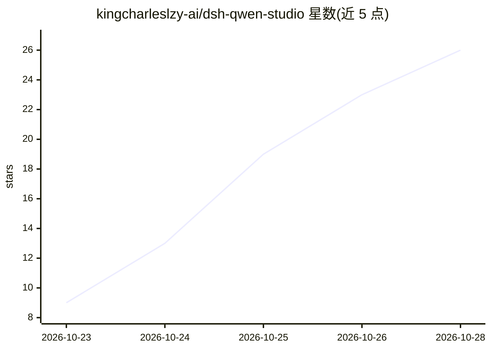

# kingcharleslzy-ai/dsh-qwen-studio

⭐ 26 · TypeScript · Apache-2.0 · 推送 2026-10-22 · [GitHub](https://github.com/kingcharleslzy-ai/dsh-qwen-studio) · [官网](https://github.com/kingcharleslzy-ai/dsh-qwen-studio#readme) · 个人维护 · 中文 README

**DeepSeek Harness 的 Qwen Image 2.1 本机生图/改图插件**

面向 DeepSeek Harness（DSH）桌面的图像插件：在 Apple Silicon 上用 MFLUX/MLX 本机运行 Qwen Image 2.1，也可接自建 NVIDIA GPU 网关，支持文生图、参考变体与原生参考编辑、LoRA、ControlNet、蒙版重绘、预设与隐私图库。自动注册 qwen-image 技能，Agent 可通过 14 个工具提交任务、查进度、批量操作与本地客观评分。模型权重不随包分发，需自行准备（量化约 40 GB 起）；不是独立生图 App，需在 DSH 内使用。

## 筛选速览

| 维度 | 判定 | 备注 |
|---|---|---|
| AI 角色 | `ai-native` | 本体是模型或模型工具 |
| 许可风险 | `permissive` | Apache-2.0 |
| 部署形态 | `library` | 以包/库形式分发 |
| 模型依赖 | locked-api |  |
| 硬件要求 | `gpu-8g` | |
| 安装摩擦 | `medium` | 含编译或系统依赖之一 |
| 成熟度 | `idea` | |

## 能力要点

- 本机 Apple Silicon MLX/MFLUX 或自建 CUDA 网关两种推理位置
- 原生参考编辑：参考图+指令共同参与生成，按完整步数采样
- Agent 可用的 14 个插件工具：导入、批量提交、状态查询、导出、客观评分、按标记重投
- 预设库 JSON 导入导出，Agent 与面板共用同一预设

## 适用场景

- 在 DSH 里对着一张参考图改画风、换颜色、编辑主体
- 让 Agent 在会话中找参考图并调用插件完成生图任务
- 用本机 LoRA 与控制图保存成套参数预设反复使用

## 场景标签

`图像生成` · 领域:内容生成

## 证据(README 行号)

> L38: **直接创作**：打开 DSH 左侧「图像」，写描述、选参考、调参数。无需文字模型代为调用。
> L44: - **按图改画风** — 本机 MLX 与配套远程网关均支持原生参考编辑。参考图片和指令共同参与生成，按完整步数采样。
> L140: 启用插件自动注册 `qwen-image` 技能，无需复制技能目录。简介、触发条件与执行步骤来自同一份技能说明。

## 星数曲线

2026-10-23 9 → 2026-10-28 26（+17）

---
*卡片 v1 · prompt 1.4 · 生成 2026-10-27 · 置信度 mid · 依据 README sha `395c81f32f5b` · [字段定义](../../DATASET.md)*
